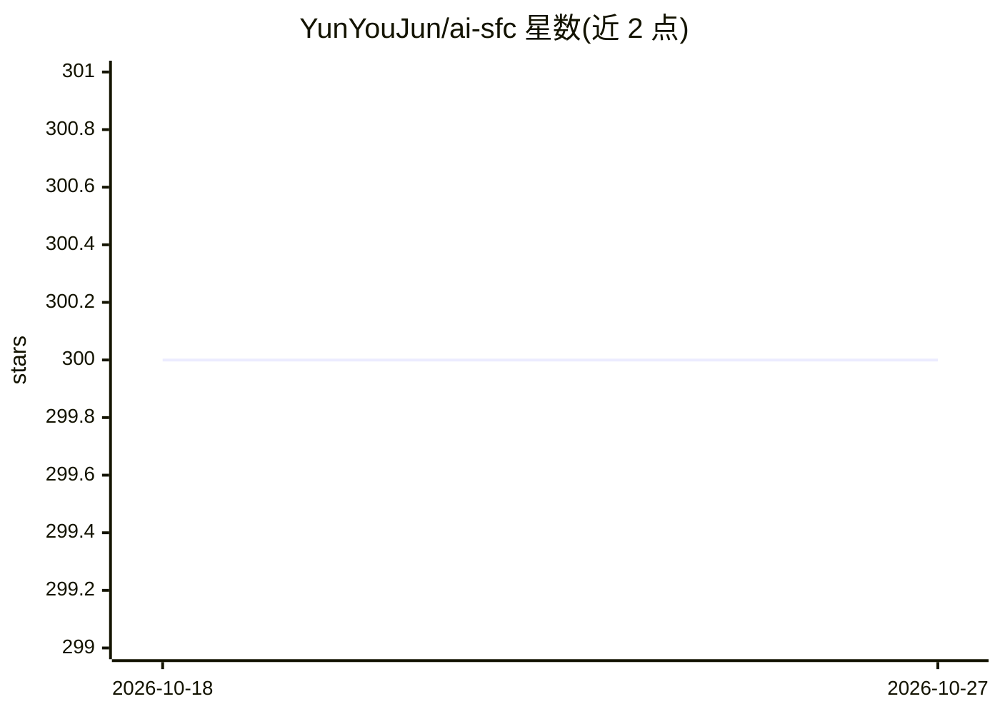

# YunYouJun/ai-sfc

⭐ 300 · TypeScript · MPL-2.0 · 推送 2026-08-20 · [GitHub](https://github.com/YunYouJun/ai-sfc) · [官网](https://ai-sfc.yunyoujun.cn) · 个人维护 · 中文 README

**AI 生成春联的 Web 应用，支持登录计费与浏览器直连**

面向春节用户的在线春联生成器，调用兼容 OpenAI 协议的模型接口生成春联文本。提供两条链路：未登录时在设置中填写模型接口与 token，浏览器直连、token 仅存本地；登录后复用 www.yunle.fun 账户（@yunlefun/sso 跨站 SSO），由服务端经 ai-runtime 统一接口计费扣云币。含横批/上下联排版说明，部署于 EdgeOne Pages 边缘函数。开发通过 .env 配置 API Key，pnpm 安装运行。

## 筛选速览

| 维度 | 判定 | 备注 |
|---|---|---|
| AI 角色 | `ai-native` | 本体是模型或模型工具 |
| 许可风险 | `permissive` | MPL-2.0 |
| 部署形态 | `library` | 以包/库形式分发 |
| 模型依赖 | — | README 未给出锁定关系 |
| 硬件要求 | — | 无带数字的原话,不猜 |
| 安装摩擦 | `low` | 无编译、无系统依赖或容器化 |
| 成熟度 | — | 结构信号不足 |

## 能力要点

- 未登录路径：OpenAI 协议接口浏览器直连，token 只存本地
- 登录路径：SSO 跨站登录 + ai-runtime 云币计费与扣费
- SSO v3 使用 Redirect、一次性授权码与 S256 PKCE
- 部署在 EdgeOne Pages 的 V8 边缘函数

## 适用场景

- 春节时在线生成春联文字
- 用自己的模型接口生成春联且 token 不经服务端
- 在云乐坊账户体系内使用计费的 AI 生成服务

## 场景标签

`AI 写作` · 领域:内容生成

## 证据(README 行号)

> L1: # AI SFC (Spring Festival Couplets) - AI 春联
> L5: > 两条生成链路：**未登录**在「设置」填兼容 OpenAI 协议的模型接口与 token，浏览器直连、token 只存本地、不经服务端；**登录**走云币计费，服务端携带云乐坊 access_token 调用统一 `ai-run

## 星数曲线

2026-10-18 300 → 2026-10-27 300（+0）

---
*卡片 v1 · prompt 1.4 · 生成 2026-10-21 · 置信度 high · 依据 README sha `60d43c9ae5cb` · [字段定义](../../DATASET.md)*
