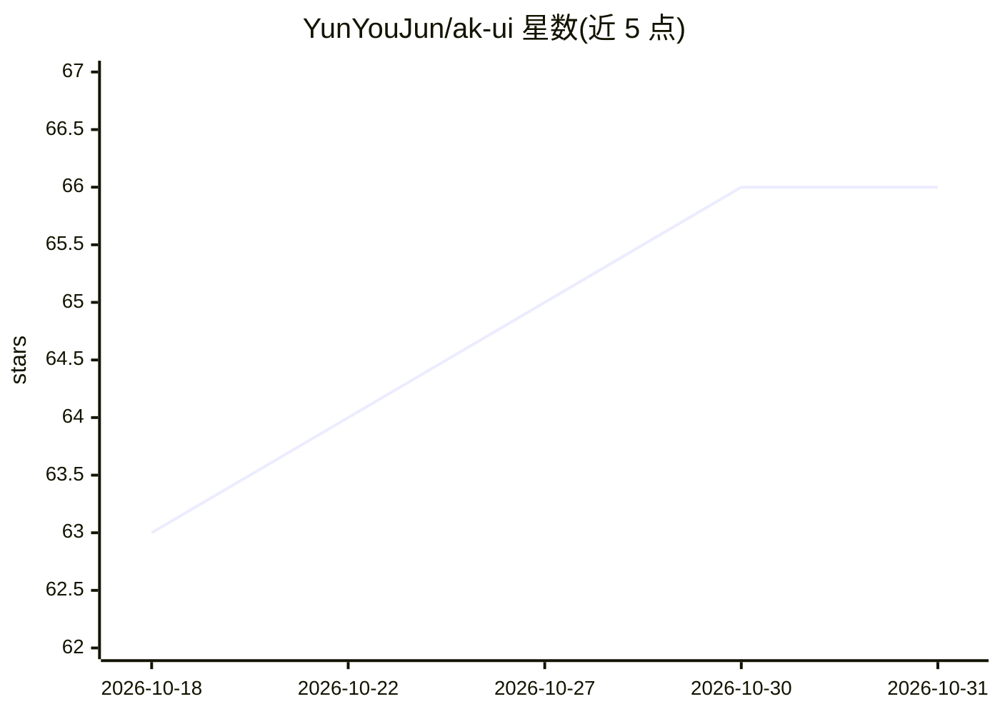

# YunYouJun/ak-ui

⭐ 66 · SCSS · MIT · 推送 2026-10-18 · [GitHub](https://github.com/YunYouJun/ak-ui) · [官网](https://ak-ui.yyj.moe) · 个人维护 · 中文 README

**明日方舟风格的 UI 设计令牌与 CSS 基础库，附 Agent Skill**

非官方的、以明日方舟为灵感的样式基础：提供语义化设计令牌（--ak-* 自定义属性）、框架无关的 CSS Core、组件指南，以及可通过 Skills CLI 安装的 Agent Skill，供 AI 或手工方式构建界面。tokens.css 不重置全局元素；包发布于 npm，运行时零依赖；Vue 用户可经 shadcn-vue CLI 复制适配器，无需单独运行时。当前稳定版 1.1.0，MIT 许可。

## 筛选速览

| 维度 | 判定 | 备注 |
|---|---|---|
| AI 角色 | `ai-enhanced` | 去掉 AI 部分产品仍成立 |
| 许可风险 | `permissive` | MIT |
| 部署形态 | `library` | 以包/库形式分发 |
| 模型依赖 | — | README 未给出锁定关系 |
| 硬件要求 | — | 无带数字的原话,不猜 |
| 安装摩擦 | `low` | 无编译、无系统依赖或容器化 |
| 成熟度 | — | 结构信号不足 |

## 能力要点

- 语义化设计令牌 + 框架无关 CSS Core，运行时零依赖
- 可安装的 Agent Skill（npx skills add），让 AI agent 集成该设计语言
- 三种风格强度：accent / system / terminal
- Vue Registry 经 shadcn-vue CLI 复制可编辑适配器，无独立运行时

## 适用场景

- 为自己的产品构建明日方舟工业风界面
- 让 AI agent 按该设计语言集成或扩展现有项目界面
- 配合 headless 组件库（如 Reka UI）做样式映射

## 场景标签

 · 领域:前端/设计系统

## 证据(README 行号)

> L9: An unofficial, Arknights-inspired styling foundation for building original interfaces with AI or by hand. ak-ui prov
> L24: ## Use with AI (recommended)
> L29: npx skills add YunYouJun/ak-ui --skill ak-ui

## 星数曲线

2026-10-18 63 → 2026-10-31 66（+3）

---
*卡片 v1 · prompt 1.4 · 生成 2026-10-24 · 置信度 high · 依据 README sha `a2d8adfa21ea` · [字段定义](../../DATASET.md)*
