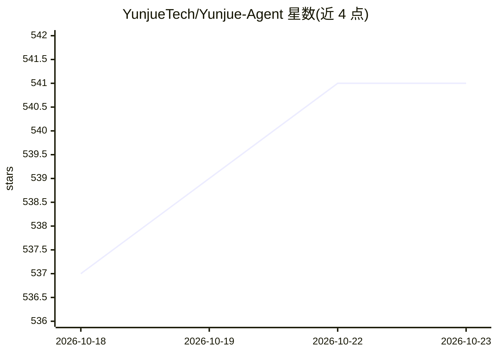

# YunjueTech/Yunjue-Agent

⭐ 541 · Python · Apache-2.0 · 推送 2026-03-06 · [GitHub](https://github.com/YunjueTech/Yunjue-Agent) · [官网](https://www.yunjuetech.com/Yunjue-Agent/) · 组织维护 · 中文 README

**零起点自进化 agent 系统：运行时自主合成与复用工具**

Yunjue Technology 开源的 In-Situ Self-Evolving agent 系统官方实现，面向开放式任务：以空工具库（zero-start）启动，通过推理时生成、验证与归纳迭代合成、优化和复用工具，将短期执行反馈蒸馏为长期可复用能力，并以 Parallel Batch Evolution 策略提升进化效率。在 HLE、DeepSearchQA 等 5 个基准下提供复现分支、系统轨迹与演化工具等开放资产，附 Web Demo 与 CLI Skill Demo。要求 Python 3.12+、uv，目前仅在 MacOS 测试；提供 arXiv 技术报告与 Hugging Face 数据集。

## 筛选速览

| 维度 | 判定 | 备注 |
|---|---|---|
| AI 角色 | `ai-native` | 本体是模型或模型工具 |
| 许可风险 | `permissive` | Apache-2.0 |
| 部署形态 | `None` |  |
| 模型依赖 | — | README 未给出锁定关系 |
| 硬件要求 | — | 无带数字的原话,不猜 |
| 安装摩擦 | `low` | 无编译、无系统依赖或容器化 |
| 成熟度 | — | 结构信号不足 |

## 能力要点

- 零起点（空工具库）下依靠推理时生成、验证与归纳实现能力扩张
- 以工具进化为主线，代码执行成败作为二元反馈信号
- 发布端到端代码、基准脚本、版本化工具产物与完整交互轨迹
- 提供 Web Demo 与 CLI Skill Demo（基于 SKILL.md 生成执行工具）

## 适用场景

- 在开放式搜索/研究类任务上运行可自进化的 agent
- 复现论文在 5 个基准上的零起点实验结果
- 分析工具演化收敛与进化效率的系统轨迹

## 场景标签

`Agent 框架` · 领域:Agent 开发

## 证据(README 行号)

> L83: Conventional agent systems often struggle in open-ended environments where task distributions continuously drift an
> L95:  Starting with an **empty tool library** (Zero-Start), our system achieves State-of-the-Art performance by relying 
> L22: - **[2026-02-11]** 🎬 **Demo Release**: We implemented two demos (Web Demo and CLI Skill Demo). See Demo Quick Start

## 星数曲线

2026-10-18 537 → 2026-10-23 541（+4）

---
*卡片 v1 · prompt 1.4 · 生成 2026-10-21 · 置信度 high · 依据 README sha `c49225b544e1` · [字段定义](../../DATASET.md)*
