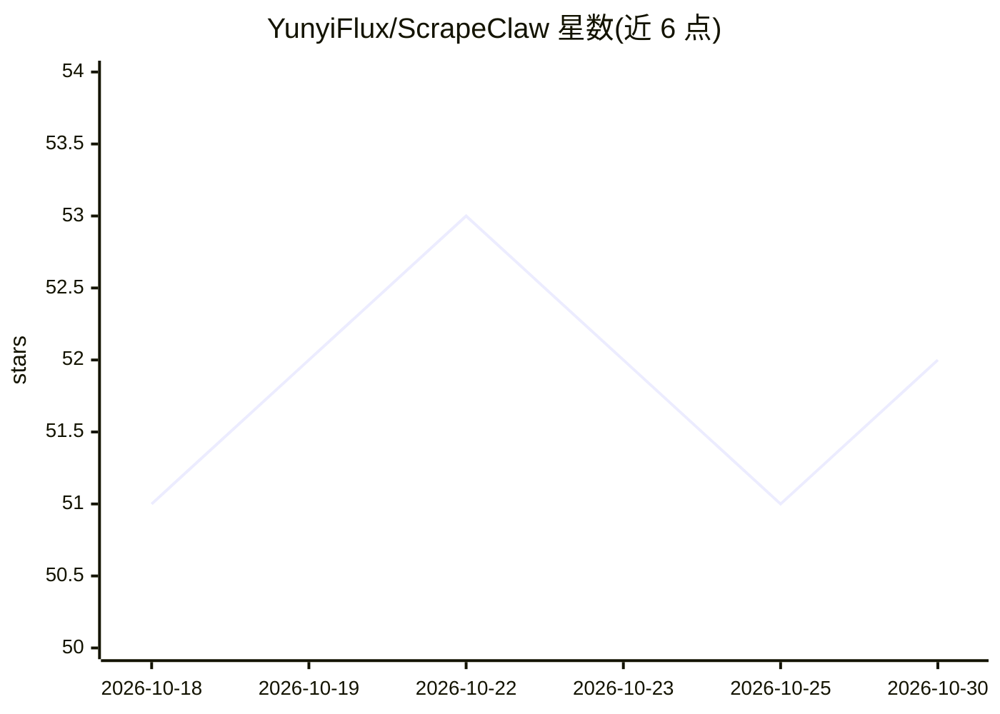

# YunyiFlux/ScrapeClaw

⭐ 52 · Python · MIT · 推送 2026-09-20 · [GitHub](https://github.com/YunyiFlux/ScrapeClaw) · 个人维护 · 中文 README

**自动逆向 SPA 并生成独立 Python 爬虫的 AI agent**

面向开发者的爬虫合成 agent：输入目标 URL 与自然语言提取目标，用无头浏览器探测页面、截获 XHR/Fetch 流量以发现私有 API，分析流量后生成可独立运行的 Python 爬虫（httpx 单文件、scrapy 工业项目或 DrissionPage 混合引擎），无需浏览器依赖。支持逆向客户端 JS 签名函数并生成 Node.js 签名模块、cookie/session 注入与 Cloudflare Turnstile 验证码处理，爬虫在沙箱子进程中验证后才交付。提供 CLI、交互式向导与 Python SDK；客户端签名逆向需可选安装 Node.js (v18+)。

## 筛选速览

| 维度 | 判定 | 备注 |
|---|---|---|
| AI 角色 | `ai-native` | 本体是模型或模型工具 |
| 许可风险 | `permissive` | MIT |
| 部署形态 | `None` |  |
| 模型依赖 | — | README 未给出锁定关系 |
| 硬件要求 | — | 无带数字的原话,不猜 |
| 安装摩擦 | `low` | 无编译、无系统依赖或容器化 |
| 成熟度 | — | 结构信号不足 |

## 能力要点

- 浏览器仅作探测，最终交付零浏览器依赖的独立爬虫
- 三种引擎脚手架：httpx / scrapy / DrissionPage
- 逆向客户端 JS 签名并生成解耦 Node.js 签名模块
- 沙箱子进程中执行验证后才交付爬虫

## 适用场景

- 不想写浏览器自动化，直接拿到纯 Python 爬虫脚本
- 逆向带客户端签名/token 的 SPA 私有 API
- 批量生成工业级 Scrapy 项目并导出 CSV/JSON/JSONL 数据

## 场景标签

`网页抓取` `代码生成` · 领域:效率与自动化

## 证据(README 行号)

> L10: **ScrapeClaw** is an AI agent designed to reverse-engineer modern single-page applications (SPAs built with Vue, Re
> L14: - **Pure Python Spider as Deliverable**: The agent analyzes captured traffic, prunes redundant headers, deduces pag

## 星数曲线

2026-10-18 51 → 2026-10-30 52（+1）

---
*卡片 v1 · prompt 1.4 · 生成 2026-10-24 · 置信度 high · 依据 README sha `9bdeaaf86ed2` · [字段定义](../../DATASET.md)*
