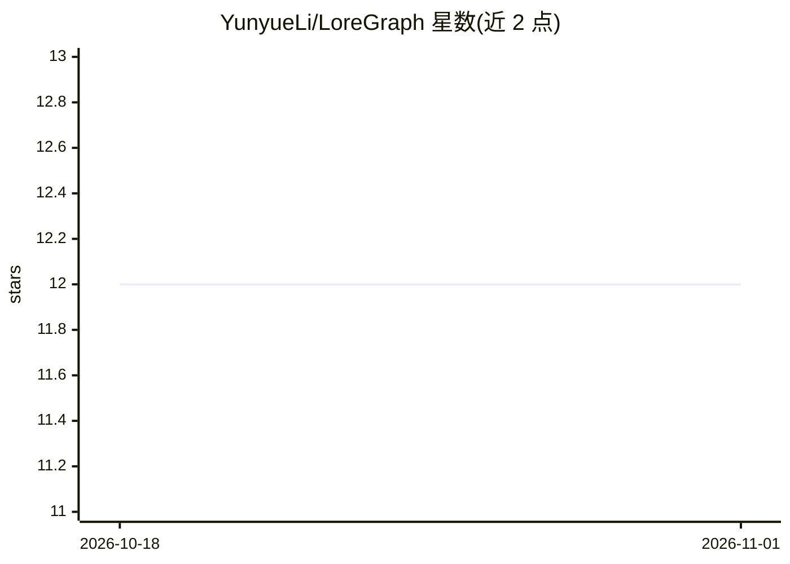

# YunyueLi/LoreGraph

⭐ 12 · HTML · Apache-2.0 · 推送 2026-08-05 · [GitHub](https://github.com/YunyueLi/LoreGraph) · [官网](https://loregraph.ungetsu.net) · 个人维护 · 中文 README

**从虚构文本生成可溯源知识图谱的工具，供文学研究者与开发者使用**

LoreGraph 将小说、剧本、歌剧脚本等虚构文本转换为可查询的知识图谱：抽取人物、物件、事件、概念及其类型化关系，每条抽取结果都携带原文证据片段，并由验证环节丢弃证据片段非字面匹配（≥95%）的声明。采用闭世界设定，只报告文本内信息。支持多语言端到端处理（含中文、日文等 11 种语言），通过多语言嵌入模型做跨文字系统实体合并。默认经 OpenRouter 调用 DeepSeek V4 Pro，可切换 15+ 后端（含 Ollama 本地）。需要 Postgres 数据库，使用 uv 安装，处于 Alpha 状态。

## 筛选速览

| 维度 | 判定 | 备注 |
|---|---|---|
| AI 角色 | `ai-native` | 本体是模型或模型工具 |
| 许可风险 | `permissive` | Apache-2.0 |
| 部署形态 | `None` |  |
| 模型依赖 | local-ok | 支持本地模型 |
| 硬件要求 | — | 无带数字的原话,不猜 |
| 安装摩擦 | `low` | 无编译、无系统依赖或容器化 |
| 成熟度 | `idea` | |

## 能力要点

- 8 阶段流水线，每条声明锚定原文证据片段并有 ≥95% 字面匹配验证门槛
- 闭世界抽取：跨文字系统实体合并（如「林黛玉/颦儿」归并为一节点）
- 提供 Reader/Graph/Timeline/Index/Ask 五视图的网络阅览室
- 多提供商客户端（OpenRouter 默认，支持 Anthropic/OpenAI/DeepSeek/Ollama 等）与按书成本上限

## 适用场景

- 文学研究者对长篇虚构作品做人物关系与事件的结构化分析
- 构建带原文溯源的虚构作品知识图谱并做基于图谱的问答
- 对多语言文本（中/英/俄/日等）做跨别名实体合并与关系抽取

## 场景标签

`知识图谱` `RAG` · 领域:知识与检索

## 证据(README 行号)

> L5: LoreGraph turns a novel, play, screenplay, or libretto into a **queryable knowledge graph** —
> L62: A book flows through eight passes (diagram above). Chunking is deterministic; the rest are LLM calls that

## 星数曲线

2026-10-18 12 → 2026-11-01 12（+0）

---
*卡片 v1 · prompt 1.4 · 生成 2026-11-01 · 置信度 high · 依据 README sha `8ac27d5d6a56` · [字段定义](../../DATASET.md)*
