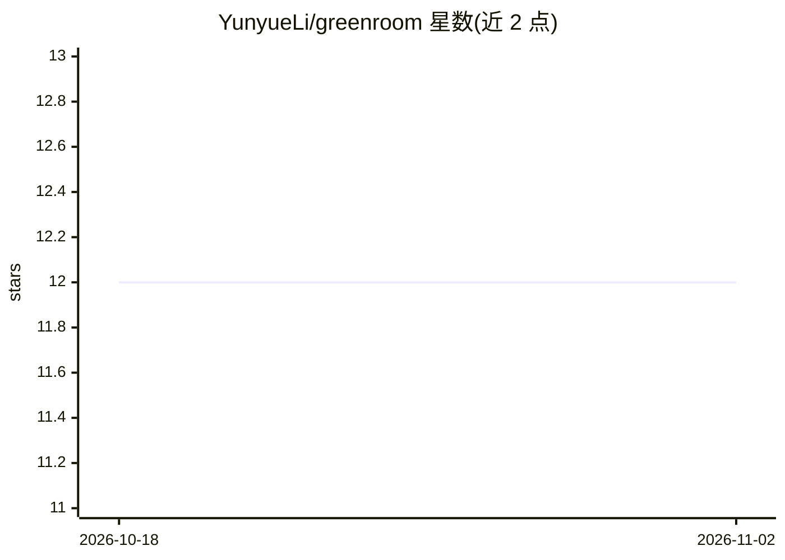

# YunyueLi/greenroom

⭐ 12 · Python · AGPL-3.0 · 推送 2026-09-07 · [GitHub](https://github.com/YunyueLi/greenroom) · [官网](https://greenroom.ungetsu.net/) · 个人维护 · 中文 README

**面试准备 agent 技能包：7 个技能+163 条岗位知识+Markdown 工作台格式**

greenroom core 是面向求职者面试准备的开放层，运行于用户自己的 agent（如 Claude Code）中：提供 7 个 Agent Skills（JD 解析、故事卡挖掘、面试脚本、模拟面试、复盘等）、163 条覆盖 27 个职能/行业组的公开岗位知识条目，以及一个可移植的 Markdown 工作台契约与格式转换工具。它不含产品 UI、后端或托管模型；完整产品仅通过官方托管服务提供，无自托管版。许可证为 AGPL-3.0，品牌受 TRADEMARK.md 约束。

## 筛选速览

| 维度 | 判定 | 备注 |
|---|---|---|
| AI 角色 | `ai-ecosystem` | LLM/agent 周边工具 |
| 许可风险 | `viral` | AGPL-3.0 |
| 部署形态 | `library` | 以包/库形式分发 |
| 模型依赖 | — | README 未给出锁定关系 |
| 硬件要求 | — | 无带数字的原话,不猜 |
| 安装摩擦 | `low` | 无编译、无系统依赖或容器化 |
| 成熟度 | — | 结构信号不足 |

## 能力要点

- 7 个 Agent Skills 覆盖从 JD 解析到模拟面试与复盘的流程
- 163 条岗位知识条目（27 个职能/行业组），不含候选人数据
- 公开的 Markdown 工作台契约与 workspace_codec.py 格式转换工具
- 可在任何支持 Agent Skills 的工具中安装，工作区文件留在本地

## 适用场景

- 让我的 agent 端到端准备某岗位的面试
- 把简历事实整理成可口头讲述的故事卡与第一人称回答
- 模拟面试并生成教练报告与复盘修改清单
- 基于公开工作台契约构建兼容工具

## 场景标签

 · 领域:求职/职业发展

## 证据(README 行号)

> L25: |1,443 role profiles across 43 industries; one workspace from discovery to the live interview|7 Agent Skills and 16
> L84: Install the versioned plugin in Claude Code:

## 星数曲线

2026-10-18 12 → 2026-11-02 12（+0）

---
*卡片 v1 · prompt 1.4 · 生成 2026-11-01 · 置信度 high · 依据 README sha `b20acde6fe5a` · [字段定义](../../DATASET.md)*
