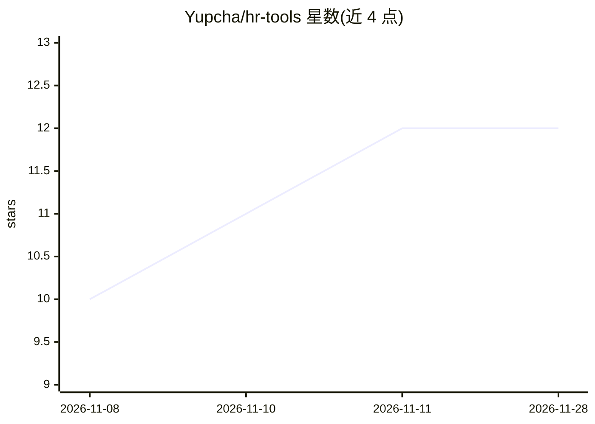

# Yupcha/hr-tools

⭐ 12 · TypeScript · MIT · 推送 2026-07-02 · [GitHub](https://github.com/Yupcha/hr-tools) · [官网](https://yupcha.com) · 个人维护

**面向 HR/招聘/教师的 60+ 工具离线桌面工具箱**

基于 Tauri + React 的桌面应用，汇集 60+ HR 工具：录用信与 HR 邮件模板生成（三种语气、PDF 导出）、工资单文档、覆盖印度/美国/英国/欧洲/阿联酋/沙特/尼日利亚/南非的 8 个地区的薪资与税务计算器，以及教师用成绩换算等工具。v2 起强制仅本地运行：AI Assist 只能通过本机 Ollama 调用，Rust 后端拒绝非 localhost 端点。提供 macOS/Windows/Linux 安装包与实验性 Android APK；法定计算结果为估算值（FY 2024-25 规则），应用内标注需官方核实。

## 筛选速览

| 维度 | 判定 | 备注 |
|---|---|---|
| AI 角色 | `ai-enhanced` | 去掉 AI 部分产品仍成立 |
| 许可风险 | `permissive` | MIT |
| 部署形态 | `desktop` | 安装包/桌面程序 |
| 模型依赖 | local-ok | 支持本地模型 |
| 硬件要求 | — | 无带数字的原话,不猜 |
| 安装摩擦 | `low` | 无编译、无系统依赖或容器化 |
| 成熟度 | `idea` | |

## 能力要点

- 60+ 工具：信函/邮件模板、工资单、8 地区薪资税务计算器、教师工具
- v2 起强制 local-only：AI Assist 仅限本机 Ollama，Rust 后端拒绝非 localhost 端点
- 内置 MCP server，可被 Claude Desktop/Claude Code 等 agent 本地调用工具
- App Lock 可用 AES-256 口令加密已存档案

## 适用场景

- 在没有网络/不允许数据外传的环境里生成 HR 信函与工资单
- 按印度/美国/英国等地区规则估算到手工资与法定扣款
- 让本地 agent 通过 MCP 批量生成文档或运行计算器

## 场景标签

`AI 写作` · 领域:内容生成

## 证据(README 行号)

> L3: **60+ HR tools in one tiny desktop app.** Offer-letter & HR-email generators, payslips,
> L27: - **Cloud AI removed.** AI Assist now runs *only* on a local model via Ollama; the Rust backend **refuses any endpo
> L62: - 🤖 **Optional AI & agentic use** — draft with a local model (Ollama, strictly on-device), and an MCP server to dri

## 星数曲线

2026-11-08 10 → 2026-11-28 12（+2）

---
*卡片 v1 · prompt 1.4 · 生成 2026-11-18 · 置信度 high · 依据 README sha `9b054adacf79` · [字段定义](../../DATASET.md)*
