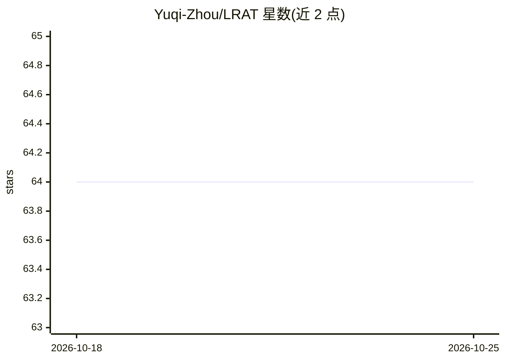

# Yuqi-Zhou/LRAT

⭐ 64 · Python · Apache-2.0 · 推送 2026-09-17 · [GitHub](https://github.com/Yuqi-Zhou/LRAT) · [官网](https://yuqi-zhou.github.io/LRAT-homepage/) · 组织维护 · 中文 README

**从多步 agent 搜索轨迹训练检索器的研究代码库**

SIGIR 2026 论文 Learning to Retrieve from Agent Trajectories 的实现：提供完整流水线，包括采集 Tongyi DeepResearch、WebExplorer、AgentCPM 等 agent 的多步搜索/浏览轨迹、用 LLM judge 将轨迹转换为检索监督数据（query/pos/neg 对）、基于本地 FlagEmbedding 配方训练检索器（BM25/faiss 后端），并在 BrowseComp-Plus 与 InfoSeek-Eval 上用本地 vLLM judge 做端到端评测。同时发布含 26,482 条成功轨迹的 LRAT-Train 数据集与模型检查点，并含 CCIR 竞赛评测代码。BM25 流水线需 Java 21。

## 筛选速览

| 维度 | 判定 | 备注 |
|---|---|---|
| AI 角色 | `ai-ecosystem` | LLM/agent 周边工具 |
| 许可风险 | `permissive` | Apache-2.0 |
| 部署形态 | `library` | 以包/库形式分发 |
| 模型依赖 | — | README 未给出锁定关系 |
| 硬件要求 | — | 无带数字的原话,不猜 |
| 安装摩擦 | `medium` | 含编译或系统依赖之一 |
| 成熟度 | — | 结构信号不足 |

## 能力要点

- 轨迹→训练数据→检索器训练→端到端评测的完整流水线
- LRAT-Train 数据集：26,482 条成功 agent 轨迹（BM25 与 Qwen3-Embedding 稠密检索）
- 支持 BM25 与 faiss 检索后端，多种 agent/LLM 后端（Tongyi、WebExplorer、AgentCPM、OpenAI 兼容 API）
- 含 CCIR A/B 榜单评测代码（B 测每轨迹限 50 次模型调用）

## 适用场景

- 复现论文或基于 agent 轨迹训练自己的检索器
- 直接使用 LRAT-Train 数据集做检索训练实验
- 参加基于 LRAT 的 CCIR Cup 竞赛

## 场景标签

`微调` · 领域:训练与推理

## 证据(README 行号)

> L37: **LRAT** studies how to train retrievers from the intermediate behaviors of strong search agents rather than from o
> L39: - collecting long-horizon search trajectories from agentic systems,
> L42: - evaluating both retrieval quality and end-to-end task success.

## 星数曲线

2026-10-18 64 → 2026-10-25 64（+0）

---
*卡片 v1 · prompt 1.4 · 生成 2026-10-24 · 置信度 mid · 依据 README sha `8e7e1f92ebac` · [字段定义](../../DATASET.md)*
