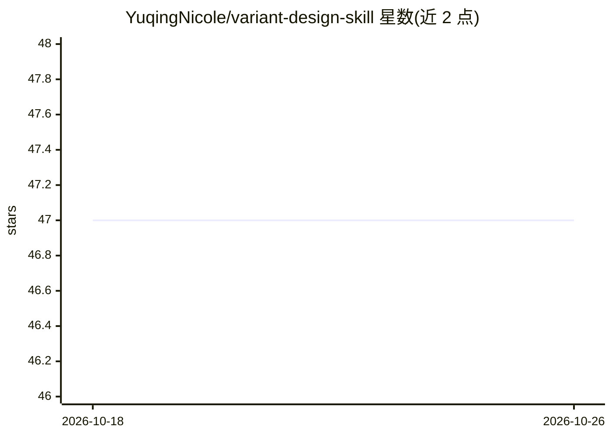

# YuqingNicole/variant-design-skill

⭐ 47 · TypeScript · MIT · 推送 2026-10-10 · [GitHub](https://github.com/YuqingNicole/variant-design-skill) · [官网](https://github.com/YuqingNicole/variant-design-skill) · 个人维护 · 中文 README

**为 Claude Code 等 agent 提供的设计技能：一条提示生成三个可迭代的设计方向**

一个安装到 Claude Code、Codex 等 agent 技能目录的 SKILL.md 技能包（含 references、scripts、assets 子目录与可执行辅助脚本，需文件访问与 Node.js）。输入一条提示后按场景加载设计系统参考资料，生成三个不同取向的设计变体，支持以单词动作（变体强化、重排配色、换风格等）迭代，输出 React .tsx 或零依赖 HTML 并自动在浏览器打开。另含 UX 审查模式（基于 Nielsen Norman Group 研究的 13 类可用性检查）与分析模式（读取现有代码提取设计 token 并生成一致性报告）。附一个 React + Vite 的双语提示词试验网站。

## 筛选速览

| 维度 | 判定 | 备注 |
|---|---|---|
| AI 角色 | `ai-ecosystem` | LLM/agent 周边工具 |
| 许可风险 | `permissive` | MIT |
| 部署形态 | `None` |  |
| 模型依赖 | — | README 未给出锁定关系 |
| 硬件要求 | — | 无带数字的原话,不猜 |
| 安装摩擦 | `low` | 无编译、无系统依赖或容器化 |
| 成熟度 | — | 结构信号不足 |

## 能力要点

- 一条提示生成 3 个不同设计方向，品牌锁定下保持 token 一致
- 10 种迭代动作（vary/remix colors/shuffle layout/add motion 等）与跨会话上下文持久化
- UX Review：基于 Nielsen 启发式的 13 类可用性评估，违规按严重度分级
- Analyze 模式读取现有 HTML/CSS/JSX/Vue/Svelte 提取设计 token 并生成审计报告

## 适用场景

- 设计初期快速获得多个可选的界面方向再筛选迭代
- 让 agent 按我现有设计系统生成风格匹配的新页面
- 对现有站点做可用性与样式一致性审查并导出设计 token

## 场景标签

`代码生成` · 领域:编码与开发

## 证据(README 行号)

> L7: A Claude Code skill inspired by the Variant design community, powered by the **Impeccable design system**. Give it a
> L92: Install the **complete repository**, preserving `SKILL.md`, `skills/`, `references/`, `scripts/`, `assets/`, and `V

## 星数曲线

2026-10-18 47 → 2026-10-26 47（+0）

---
*卡片 v1 · prompt 1.4 · 生成 2026-10-25 · 置信度 high · 依据 README sha `2383df1fa71e` · [字段定义](../../DATASET.md)*
