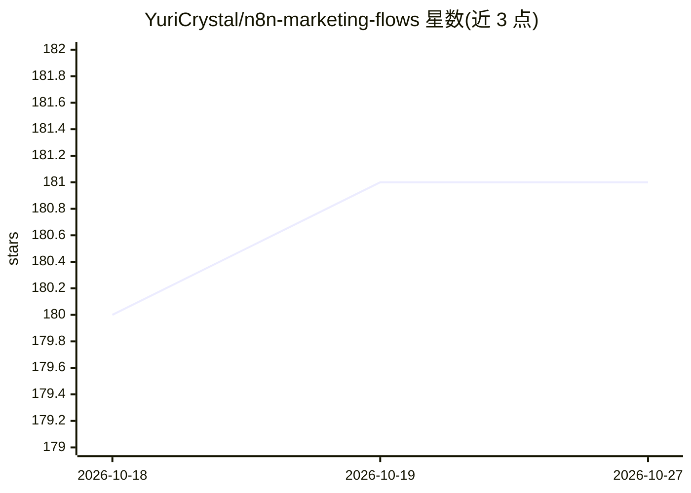

# YuriCrystal/n8n-marketing-flows

⭐ 181 · MIT · 推送 2026-06-27 · [GitHub](https://github.com/YuriCrystal/n8n-marketing-flows) · 个人维护 · 中文 README

**n8n 行销自动化工作流模板库（81 支 JSON，含免 key 本机版）**

可一键匯入 n8n 的工作流模板集合，共 81 支 JSON，覆盖社群发文、舆情监测、新闻汇整、广告管理、AI 生图生影等行销情境。分三类：通用版（默认 Claude + Email）、*.local-ollama.json 免金钥本机版 19 支（Ollama + RSS/爬虫 + Discord 输出，匯入即用）、*.skeleton.json 待接 key 架构範本 59 支（credential 留空，未经实机 API 验证）。每支附中文说明、节点流程与所需凭证，模板本身不含任何金钥。

## 筛选速览

| 维度 | 判定 | 备注 |
|---|---|---|
| AI 角色 | `ai-knowledge` | 知识聚合/清单类 |
| 许可风险 | `permissive` | MIT |
| 部署形态 | `None` |  |
| 模型依赖 | local-ok | 支持本地模型 |
| 硬件要求 | — | 无带数字的原话,不猜 |
| 安装摩擦 | `low` | 无编译、无系统依赖或容器化 |
| 成熟度 | `idea` | |

## 能力要点

- 81 支可匯入 n8n 的工作流模板，按通用版/本机 Ollama 版/待接 key 範本三类命名
- 19 支免 key 本机版：Ollama + RSS/公开爬虫 + Discord 推播，匯入即用
- 需要 LLM 的模板默认呼叫 Anthropic Claude，可改 OpenAI 或相容端点
- 59 支 skeleton 範本附说明便利贴，仅经匯入验证、未经实机 API 结果验证

## 适用场景

- 行销人员免写程式在自架 n8n 上跑社群贴文与舆情监测流程
- 用本机 Ollama 免费运行生成与分析类工作流
- 填入自己的平台 API 金钥后发布社群、看数据、管广告

## 场景标签

`工作流自动化` `精选清单` · 领域:效率与自动化

## 证据(README 行号)

> L42: > **兩種版本**：`*.json` 為通用版（預設 Claude + Email）；`*.local-ollama.json` 為**免 key 本機版**（呼叫本機 Ollama、隨用工具直接看輸出、監測類推 Discord
> L64: `templates/` 共 **81 支**，涵蓋常見行銷自動化情境中**可開源實作的部分**（約 10 種依賴顧客數據平台／CDP，無法用開源複製，見 ROADMAP）。命名規則：
> L74: 需要 LLM 的模板預設呼叫 **Anthropic Claude**（`claude-haiku-4-5` 兼顧成本與品質，可自行改成 `claude-opus-4-8`）。也可以換成 OpenAI 或任何相容端點——詳見各模板

## 星数曲线

2026-10-18 180 → 2026-10-27 181（+1）

---
*卡片 v1 · prompt 1.4 · 生成 2026-10-22 · 置信度 mid · 依据 README sha `ea2e4b0d692f` · [字段定义](../../DATASET.md)*
