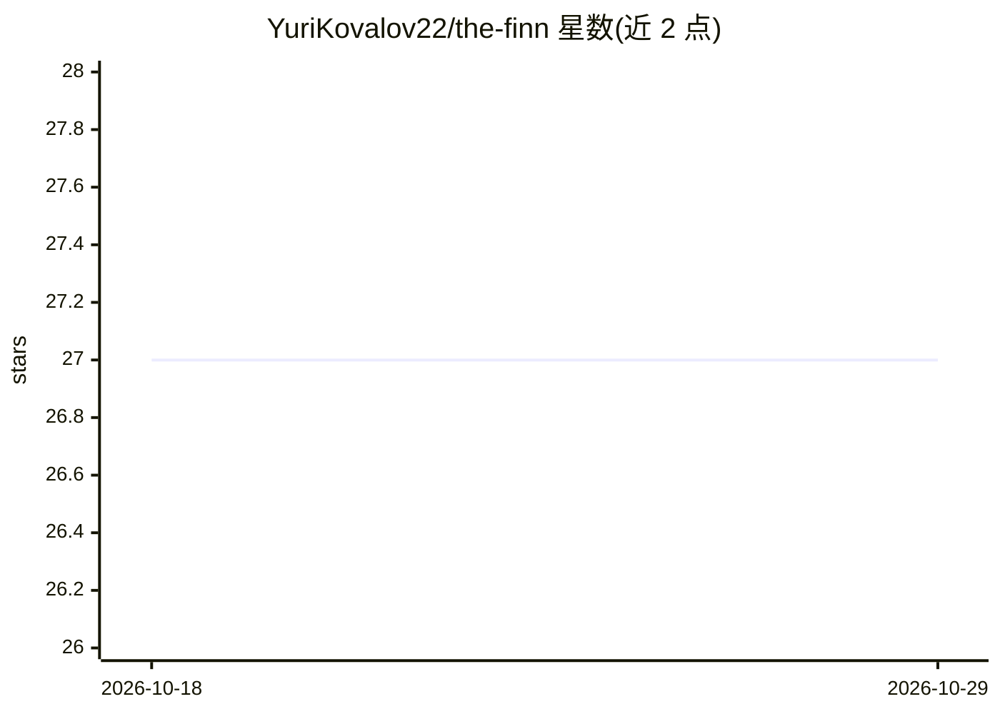

# YuriKovalov22/the-finn

⭐ 27 · Lua · MIT · 推送 2026-09-17 · [GitHub](https://github.com/YuriKovalov22/the-finn) · [官网](https://github.com/YuriKovalov22/the-finn/blob/main/docs/how-he-decides-what-to-say.md) · 个人维护

**跑在 OpenWrt 路由器上的 LLM 网络观察 agent，用 Telegram 发言**

以 Lua 编写、部署在 OpenWrt 路由器（测试于 GL.iNet GL-MT3000，512 MB RAM）上的网络观察 agent：每分钟读取路由器自身的流量、设备、端口等读数，保留滚动历史，用数值区间偏移与集合成员变化两类通用规则检测异常，再由 LLM 把异常写成角色化评论，经 Telegram bot 交付给指定用户，可选每日一条发到 Bluesky。模型可接云端 Anthropic/OpenAI 或局域网内任何 OpenAI 兼容服务（Ollama、vLLM 等）。无工具调用、无长期记忆，仅状态文件；通过 install.sh 安装到路由器并注册 cron。

## 筛选速览

| 维度 | 判定 | 备注 |
|---|---|---|
| AI 角色 | `ai-native` | 本体是模型或模型工具 |
| 许可风险 | `permissive` | MIT |
| 部署形态 | `None` |  |
| 模型依赖 | local-ok | 支持本地模型 |
| 硬件要求 | — | 无带数字的原话,不猜 |
| 安装摩擦 | `low` | 无编译、无系统依赖或容器化 |
| 成熟度 | — | 结构信号不足 |

## 能力要点

- 数值区间 + 集合成员变化两类通用异常检测，无预定义事件清单
- 云端或局域网本地模型均可驱动（OpenAI 兼容接口）
- 对外发帖在代码层脱敏（MAC/IP 截断），watchdog 内容不外发
- 按 kind/theme/shape 三轴强制评论多样性，流量类言论限流

## 适用场景

- 家用/办公网络异常事件的自然语言播报
- 服务器宕机时由路由器这个爆炸半径外的观察点发出警报
- 断外网情况下仍可运行的本地 LLM 机器人

## 场景标签

`网络安全` · 领域:学习与行业

## 证据(README 行号)

> L22: still works, which was most of the point. The words come from a model, and that model can be
> L23: a cloud one or a box on your own network; with a local one he keeps talking with the
> L138: The router does the sensing, the remembering and the deciding; the model only writes the

## 星数曲线

2026-10-18 27 → 2026-10-29 27（+0）

---
*卡片 v1 · prompt 1.4 · 生成 2026-10-26 · 置信度 high · 依据 README sha `83a3c416f32a` · [字段定义](../../DATASET.md)*
