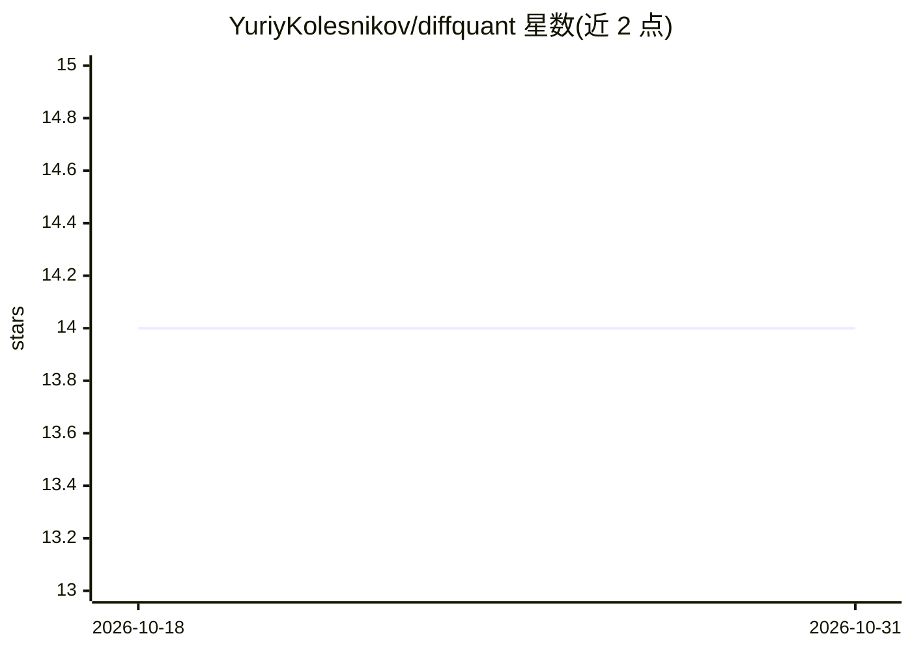

# YuriyKolesnikov/diffquant

⭐ 14 · Python · 推送 2026-04-15 · [GitHub](https://github.com/YuriyKolesnikov/diffquant) · 个人维护

**端到端可微交易研究管线：用反向传播直接优化交易策略**

基于 PyTorch 的量化交易研究框架：将特征、iTransformer/LSTM 策略网络、可微模拟器与 Sharpe 损失组成单一可微计算图，通过时间反向传播端到端训练仓位策略。模拟器以张量运算实现逐 bar 的 mark-to-market 结算（含 smooth_abs 处理交易成本），采用连续 walk-forward 协议保证验证与回测机制一致。数据为 BTCUSDT 永续合约 1 分钟 K 线（HuggingFace 提供）。README 明确声明为研究项目、非生产可用系统，无实盘执行层，超参数敏感。

## 筛选速览

| 维度 | 判定 | 备注 |
|---|---|---|
| AI 角色 | `ai-native` | 本体是模型或模型工具 |
| 许可风险 | `permissive` | — |
| 部署形态 | `library` | 以包/库形式分发 |
| 模型依赖 | — | README 未给出锁定关系 |
| 硬件要求 | — | 无带数字的原话,不猜 |
| 安装摩擦 | `low` | 无编译、无系统依赖或容器化 |
| 成熟度 | `idea` | |

## 能力要点

- 单一可微计算图：特征→策略网络→可微模拟器→−Sharpe 损失端到端训练
- direction×gate 策略头实现可微的动作屏蔽
- 训练与回测统一使用连续 walk-forward 协议，无前视、无 episode 重置
- 在 BTCUSDT 两个不重叠的持有期上报告了正的样本外年化 Sharpe

## 适用场景

- 研究通过可微模拟器直接优化交易目标的策略训练范式
- 复现 iTransformer/LSTM 骨干与混合损失的对照实验
- 扩展到多资产组合或接入实盘执行前的策略研究基础

## 场景标签

`金融量化` · 领域:学习与行业

## 证据(README 行号)

> L16: features[t−ctx:t] → PolicyNetwork → position_t → DiffSimulator → −Sharpe → ∂/∂θ
> L123: ## Experimental status

## 星数曲线

2026-10-18 14 → 2026-10-31 14（+0）

---
*卡片 v1 · prompt 1.4 · 生成 2026-10-31 · 置信度 mid · 依据 README sha `f71b33097d04` · [字段定义](../../DATASET.md)*
