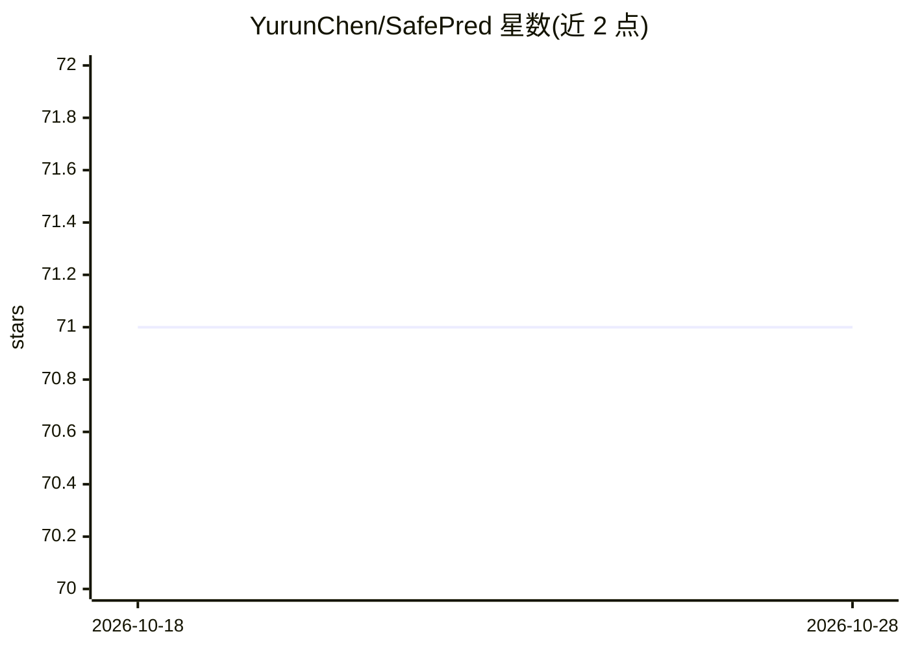

# YurunChen/SafePred

⭐ 71 · Python · 推送 2026-03-04 · [GitHub](https://github.com/YurunChen/SafePred) · 个人维护

**面向计算机使用代理的预测式安全护栏（论文官方实现）**

论文 "SafePred: A Predictive Guardrail for Computer-Using Agents via World Models" 的官方实现。它用世界模型基于安全策略生成短期与长期语义风险表征，在动作执行前识别并剪除导向高风险状态的动作，并通过步骤级干预与任务级重规划将预测风险转为决策指导。提供 SafePredWrapper 封装，可集成到 WASP 与 OS-Harm 基准或通过适配器扩展到新基准。运行需配置 LLM API key、conda 环境及 VM/云实例（如 AWS EC2）部署基准环境。

## 筛选速览

| 维度 | 判定 | 备注 |
|---|---|---|
| AI 角色 | `ai-ecosystem` | LLM/agent 周边工具 |
| 许可风险 | `none` | — |
| 部署形态 | `library` | 以包/库形式分发 |
| 模型依赖 | — | README 未给出锁定关系 |
| 硬件要求 | — | 无带数字的原话,不猜 |
| 安装摩擦 | `low` | 无编译、无系统依赖或容器化 |
| 成熟度 | — | 结构信号不足 |

## 能力要点

- 世界模型驱动的短/长期风险预测与高风险动作剪除
- 步骤级干预与任务级重规划的决策优化
- SafePredWrapper 封装与适配器机制，支持扩展到新基准
- 在 WASP 与 OS-Harm 两个基准上运行实验的完整流程

## 适用场景

- 在 CUA 执行动作前评估并拦截高风险行为
- 将预测式护栏集成到自有 agent 基准中
- 复现论文在 WASP / OS-Harm 上的安全实验

## 场景标签

 · 领域:AI Agent 安全/护栏

## 证据(README 行号)

> L13: We propose a **predictive guardrail** approach: align predicted future risks with current decisions. **SafePred** i
> L15: - **Short- and long-term risk prediction** — Using safety policies as the basis, SafePred leverages a world model t
> L126: SafePred provides a wrapper for easy integration with benchmarks. This section explains how to integrate SafePred 

## 星数曲线

2026-10-18 71 → 2026-10-28 71（+0）

---
*卡片 v1 · prompt 1.4 · 生成 2026-10-24 · 置信度 mid · 依据 README sha `80c4e099e772` · [字段定义](../../DATASET.md)*
