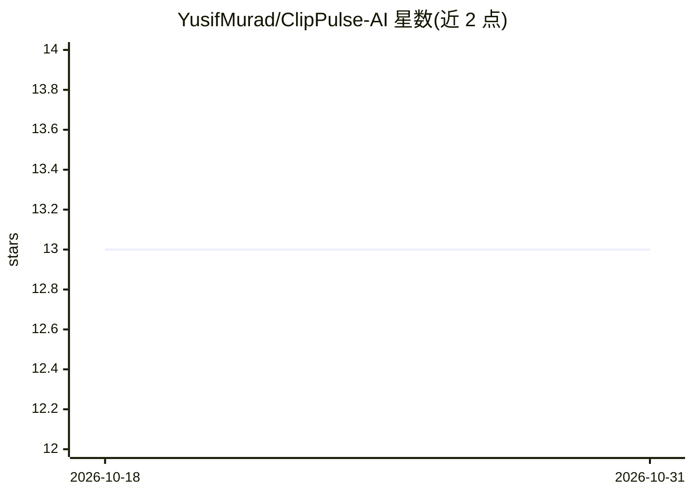

# YusifMurad/ClipPulse-AI

⭐ 13 · JavaScript · MIT · 推送 2026-10-29 · [GitHub](https://github.com/YusifMurad/ClipPulse-AI) · [官网](https://yusifmurad.github.io/ClipPulse-AI/) · 个人维护

**本地自托管的长视频 AI 切片工具，生成 9:16 竖屏短视频**

基于 Flask + Vanilla JS 的自托管 Web 应用：粘贴 YouTube 链接或上传视频，用 Whisper 转录音频、调用 Google Gemini API 对片段做病毒式潜力评分并挑选高光时刻，自动生成 9:16 竖屏剪辑，附带词级同步动画字幕、自动变焦与时间线剪辑器，可调字幕文本、颜色、缩放焦点后一键重渲染。文件全程本地处理，Gemini key 存于本地配置。需 Python 3.10+ 与 ffmpeg，从源码安装运行，支持 14 种界面语言。

## 筛选速览

| 维度 | 判定 | 备注 |
|---|---|---|
| AI 角色 | `ai-native` | 本体是模型或模型工具 |
| 许可风险 | `permissive` | MIT |
| 部署形态 | `None` |  |
| 模型依赖 | — | README 未给出锁定关系 |
| 硬件要求 | — | 无带数字的原话,不猜 |
| 安装摩擦 | `medium` | 含编译或系统依赖之一 |
| 成熟度 | — | 结构信号不足 |

## 能力要点

- Gemini 评分挑选高光片段，Whisper 转录音频
- 生成 9:16 竖屏剪辑，含词级同步动画字幕与自动变焦
- 内置时间线剪辑器：切分、删除、改字幕、改配色后重渲染
- 全部本地运行，视频文件不离开本机

## 适用场景

- 把播客、游戏、体育长视频切成 TikTok/Reels/Shorts 竖屏片段
- 在本地私密处理视频素材并精修字幕与画面
- 批量生成带动画字幕的短视频草稿

## 场景标签

`图像视频处理` · 领域:感知与多模态

## 证据(README 行号)

> L5: Paste a YouTube link or drop in your own video. ClipPulse uses **Google Gemini** to find the most engaging moments, 
> L25: 2. ClipPulse downloads (or uses your file), transcribes the audio with Whisper, and asks Gemini to rank the viral m

## 星数曲线

2026-10-18 13 → 2026-10-31 13（+0）

---
*卡片 v1 · prompt 1.4 · 生成 2026-10-31 · 置信度 high · 依据 README sha `5c2e264c21a8` · [字段定义](../../DATASET.md)*
