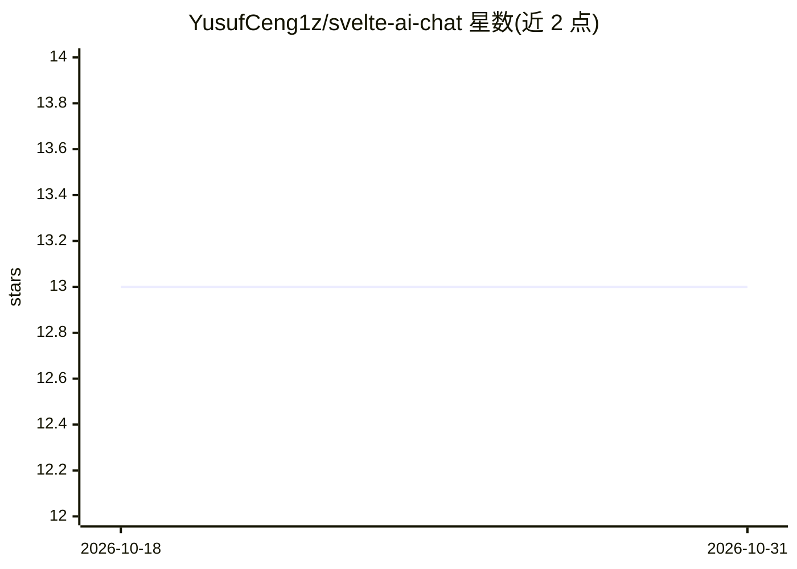

# YusufCeng1z/svelte-ai-chat

⭐ 13 · Svelte · 推送 2026-02-07 · [GitHub](https://github.com/YusufCeng1z/svelte-ai-chat) · [官网](https://svelte-ai-chat.vercel.app) · 个人维护

**Svelte 5 聊天组件：复制粘贴即用的 AI 聊天界面**

面向 Svelte 5 开发者的聊天 UI 组件：以 shadcn/ui 风格直接复制粘贴到项目中，而非 npm 安装的库。基于 Svelte 5 Runes 与 Vercel AI SDK 构建，提供 Glassmorphism 风格界面、移动端全屏模式、开箱即用的流式输出；后端通过标准 API 路由调用 streamText，支持 OpenAI、Anthropic、Groq 等提供商。代码完全归用户所有，可自定义修改。安装依赖仅需 npm install ai @ai-sdk/svelte 等包。

## 筛选速览

| 维度 | 判定 | 备注 |
|---|---|---|
| AI 角色 | `ai-ecosystem` | LLM/agent 周边工具 |
| 许可风险 | `none` | — |
| 部署形态 | `library` | 以包/库形式分发 |
| 模型依赖 | — | README 未给出锁定关系 |
| 硬件要求 | — | 无带数字的原话,不猜 |
| 安装摩擦 | `low` | 无编译、无系统依赖或容器化 |
| 成熟度 | — | 结构信号不足 |

## 能力要点

- 复制粘贴式组件（shadcn/ui 风格），代码归用户所有
- 基于 Svelte 5 Runes（$state/$effect）构建
- 开箱即用的流式输出与移动端全屏模式
- 通过 Vercel AI SDK 支持 OpenAI、Anthropic、Groq 等提供商

## 适用场景

- Svelte 项目中快速加入 AI 聊天界面而无需从零构建
- 自定义聊天组件的每个细节（无黑盒 npm 包）
- 移动端优先的 AI 聊天交互

## 场景标签

`聊天机器人` · 领域:对话与助手

## 证据(README 行号)

> L17: It's not a complex library you install. It's a nicely crafted component you **copy and paste** into your project (s
> L26: - **AI SDK Power**: Works with OpenAI, Anthropic, Groq, or whatever you use.

## 星数曲线

2026-10-18 13 → 2026-10-31 13（+0）

---
*卡片 v1 · prompt 1.4 · 生成 2026-10-31 · 置信度 mid · 依据 README sha `8dfc40945f77` · [字段定义](../../DATASET.md)*
