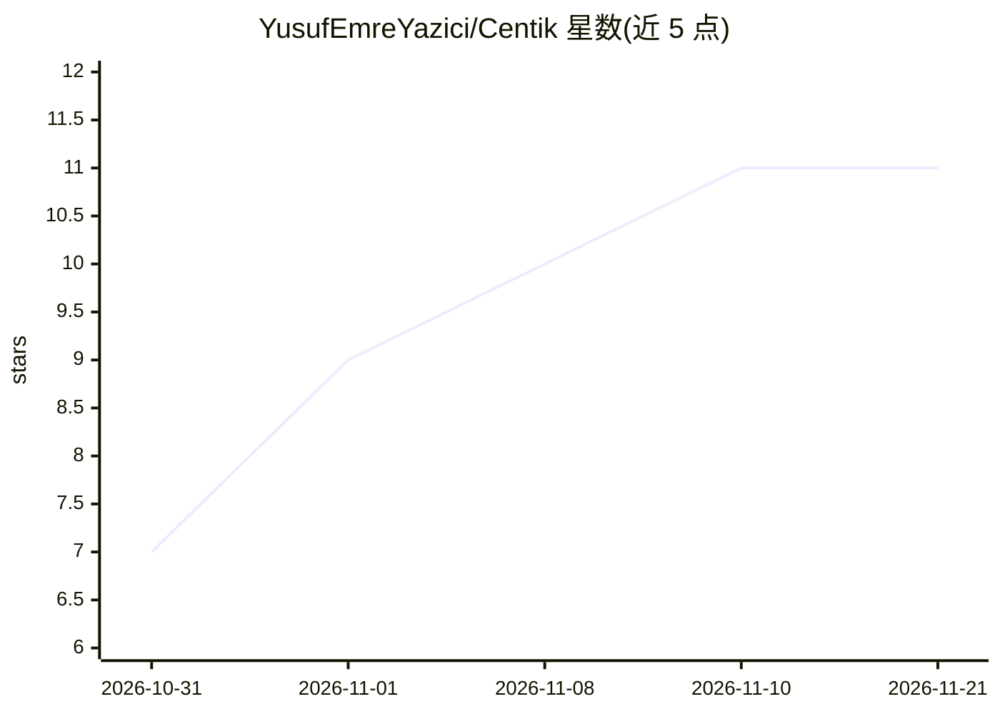

# YusufEmreYazici/Centik

⭐ 11 · Swift · MIT · 推送 2026-11-12 · [GitHub](https://github.com/YusufEmreYazici/Centik) · 个人维护

**macOS 刘海区工具岛：系统监控、音乐、剪贴板与 AI 对话**

Çentik 是一款开源 macOS 应用，将刘海区扩展为一个信息岛，提供 Spotify/Apple Music 控制、CPU/内存/GPU/网络实时图表、剪贴板历史、文件暂存架、会议倒计时、截图与下载提醒、天气、计时器与笔记等功能。AI 部分为刘海区内的聊天入口，用户自备接入方式：本机安装的 Claude Code 或 Gemini CLI、Keychain 中的 Claude/Gemini API key，或本地 Ollama，回答流式输出，仅限聊天、不能读写文件或执行命令。需要 macOS 14+，提供 Homebrew、DMG 安装与源码构建。

## 筛选速览

| 维度 | 判定 | 备注 |
|---|---|---|
| AI 角色 | `ai-enhanced` | 去掉 AI 部分产品仍成立 |
| 许可风险 | `permissive` | MIT |
| 部署形态 | `desktop` | 安装包/桌面程序 |
| 模型依赖 | local-ok | 支持本地模型 |
| 硬件要求 | — | 无带数字的原话,不猜 |
| 安装摩擦 | `low` | 无编译、无系统依赖或容器化 |
| 成熟度 | — | 结构信号不足 |

## 能力要点

- 刘海区展开的 Home/System/Clipboard/Notes 多标签岛
- AI 聊天支持 Claude Code、Gemini CLI、API key 与本地 Ollama 四种接入
- CPU/内存/GPU/网络 60 秒图表、逐核负载与可固定指标
- 剪贴板历史、文件暂存架、会议倒计时与编码 agent 提醒

## 适用场景

- 在刘海区快速查看系统状态并结束占用资源的应用
- 用自备的 Claude/Gemini 账号或本地 Ollama 在刘海区对话
- 集中管理剪贴板历史、暂存文件与新截图/下载提醒

## 场景标签

`聊天机器人` · 领域:对话与助手

## 证据(README 行号)

> L7: Music, live system stats, an AI chat, a clipboard history, a file shelf, meeting countdowns
> L36: Answers stream in as they're written. Bring your own account: an installed **Claude Code** or **Gemini CLI** (no ke

## 星数曲线

2026-10-31 7 → 2026-11-21 11（+4）

---
*卡片 v1 · prompt 1.4 · 生成 2026-11-18 · 置信度 high · 依据 README sha `fb1089ebb527` · [字段定义](../../DATASET.md)*
