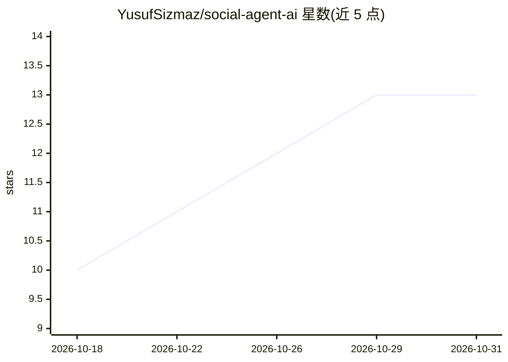

# YusufSizmaz/social-agent-ai

⭐ 13 · TypeScript · MIT · 推送 2026-09-27 · [GitHub](https://github.com/YusufSizmaz/social-agent-ai) · 个人维护

**自托管 AI 社媒自动化平台：Gemini 生成内容并多平台发布**

基于 Node.js/TypeScript 与 PostgreSQL 的自托管社交媒体自动化平台：用 Google Gemini 生成平台适配文案、Imagen 4 生成配图、Edge TTS 与 FFmpeg 组装视频，再经平台适配器发布到 Twitter/Instagram/YouTube/TikTok；按 cron 调度，每 6 小时抓取互动数据，每周一自动调整语气、时间表与话题标签策略。提供 Web 仪表盘、REST API、WhatsApp 通知、插件系统与 Docker 部署。仪表盘 UI 当前为土耳其语；视频管线需 FFmpeg（可选）。面向内容创作者、代理机构与开发者。

## 筛选速览

| 维度 | 判定 | 备注 |
|---|---|---|
| AI 角色 | `ai-native` | 本体是模型或模型工具 |
| 许可风险 | `permissive` | MIT |
| 部署形态 | `self-host` | docker 或自建部署 |
| 模型依赖 | — | README 未给出锁定关系 |
| 硬件要求 | — | 无带数字的原话,不猜 |
| 安装摩擦 | `low` | 无编译、无系统依赖或容器化 |
| 成熟度 | — | 结构信号不足 |

## 能力要点

- Gemini 文本生成 + Imagen 4 图像 + Edge TTS/FFmpeg 视频组装管线
- Twitter/Instagram/YouTube/TikTok 适配器按凭据自动启用，含限流与重试
- 每周策略优化器按 7 天数据自动调整语气、发布时间与话题标签
- PostgreSQL 任务队列与 Docker 一体化部署（含数据库、Chromium、FFmpeg）

## 适用场景

- 在自己的服务器上自动生成并多平台发布社媒内容
- 管理多品牌社媒账号并自动汇总互动数据
- 让系统按历史表现自动调整发布策略

## 场景标签

`AI 写作` `图像生成` `视频生成` · 领域:内容生成

## 证据(README 行号)

> L3: **Self-hosted, AI-powered social media automation platform**
> L22: - **AI generates your content** — Google Gemini creates platform-optimized posts with the right tone, length, and h
> L35: |**AI Text Generation**|Google Gemini (default `gemini-2.5-flash`) with structured JSON output — prompts include th

## 星数曲线

2026-10-18 10 → 2026-10-31 13（+3）

---
*卡片 v1 · prompt 1.4 · 生成 2026-10-31 · 置信度 mid · 依据 README sha `b8698faa32c4` · [字段定义](../../DATASET.md)*
