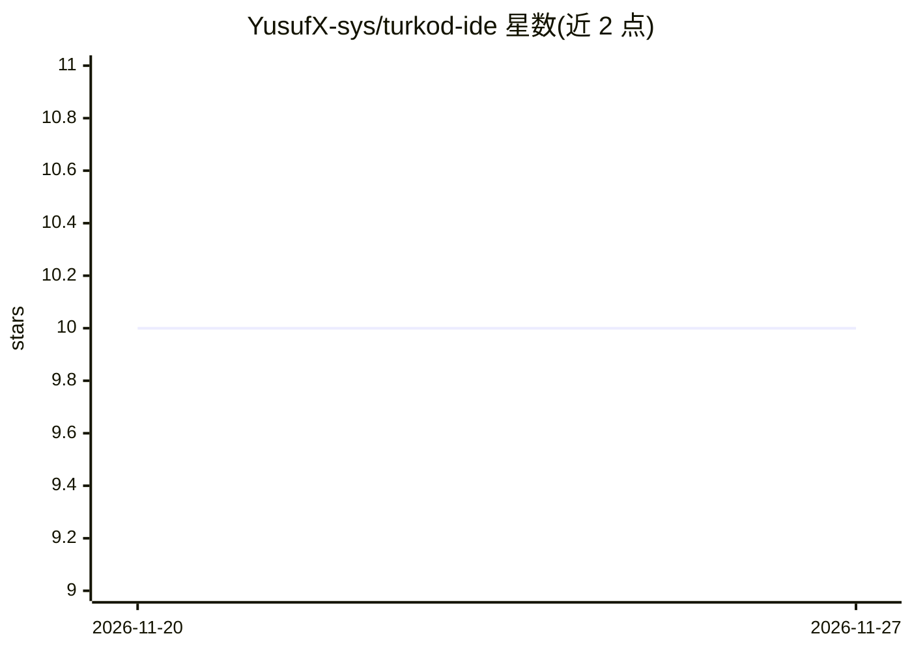

# YusufX-sys/turkod-ide

⭐ 10 · Python · MIT · 推送 2026-11-14 · [GitHub](https://github.com/YusufX-sys/turkod-ide) · 个人维护

**土耳其语语法编程学习桌面 IDE，内置 AI 助手 Kodi**

面向儿童与编程初学者的桌面 IDE，提供以土耳其语关键词为语法的 `.trpy` 编程语言，代码在后台转译为 Python 执行，错误信息以土耳其语解释。功能覆盖 VS Code 风格行内补写、断点调试器、Python 与 TürKod 双向翻译、EXE 转换、终端与命令行入口。AI 部分：内置助手 Kodi 可回答问题、找错、写代码并语音对话，支持 220+ 云服务商或离线 GGUF 本地模型（llama.cpp、NVIDIA GPU）。Windows 10/11 提供安装包，无需自装 Python。

## 筛选速览

| 维度 | 判定 | 备注 |
|---|---|---|
| AI 角色 | `ai-enhanced` | 去掉 AI 部分产品仍成立 |
| 许可风险 | `permissive` | MIT |
| 部署形态 | `desktop` | 安装包/桌面程序 |
| 模型依赖 | local-ok | 支持本地模型 |
| 硬件要求 | — | 无带数字的原话,不猜 |
| 安装摩擦 | `low` | 无编译、无系统依赖或容器化 |
| 成熟度 | — | 结构信号不足 |

## 能力要点

- `.trpy` 代码后台转译为 Python 执行，错误以土耳其语解释
- 内置 AI 助手 Kodi：答题、找错、写代码、语音对话
- 220+ 模型服务商或离线 GGUF 本地模型（llama.cpp）
- Python ⇄ TürKod 一键互译与 EXE 打包转换

## 适用场景

- 用母语语法学习编程基础概念
- 通过对话式 AI 助手排查与修复代码错误
- 将写好的程序转换为独立 EXE 分发

## 场景标签

`AI 助手` · 领域:对话与助手

## 证据(README 行号)

> L18: TürKod, Python'un gücünü Türkçe anahtar kelimelerle sunan bir programlama dili ve o dil
> L40: |🤖 **Kodi, yapay zekâ arkadaşı**|Programın içindeki robot Kodi soruları cevaplar, hatayı bulur, kod yazar, menüleri
> L42: |🧠 **Yerel ve bulut modeller**|220+ sağlayıcı (Groq, OpenAI, Anthropic, Gemini…) ya da internetsiz çalışan yerel GG

## 星数曲线

2026-11-20 10 → 2026-11-27 10（+0）

---
*卡片 v1 · prompt 1.4 · 生成 2026-11-20 · 置信度 high · 依据 README sha `9ef3c18f79a7` · [字段定义](../../DATASET.md)*
