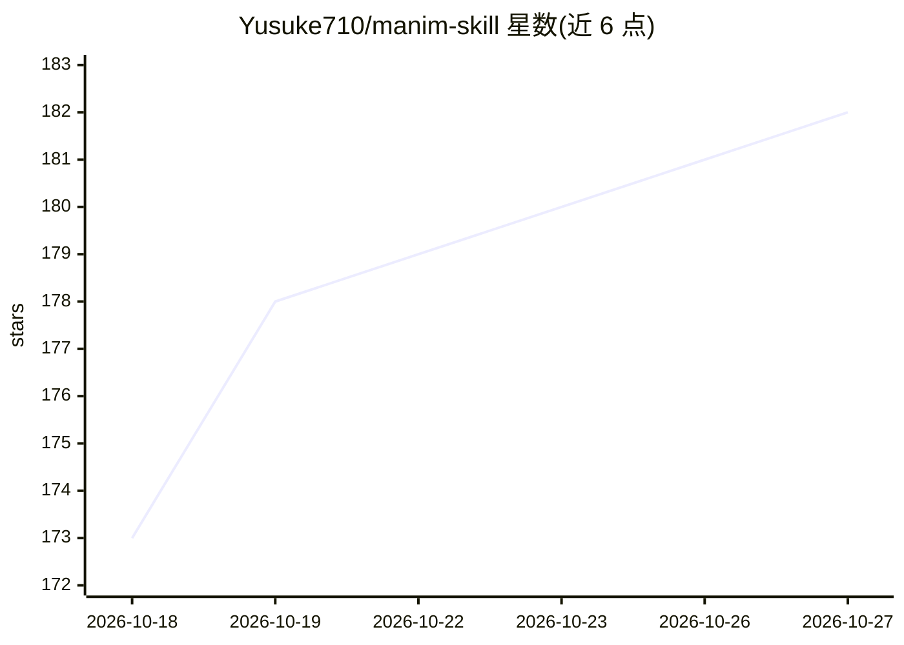

# Yusuke710/manim-skill

⭐ 182 · HTML · MIT · 推送 2026-10-07 · [GitHub](https://github.com/Yusuke710/manim-skill) · [官网](https://manimate.ai) · 个人维护

**让编程 Agent 自动生成 3Blue1Brown 风格动画视频的技能包**

面向 Claude Code 与 Codex 的 SKILL.md 技能：编码代理按「旁白→TTS→代码→渲染→混流→查看」流程自主生成 Manim 动画视频，默认开启配音旁白与时间同步字幕；旁白使用本地运行的 Kokoro TTS，无需 API key。通过浏览器视频查看器的 Capture 功能在时间戳处记录反馈，粘贴回代理迭代修改。产出文件统一写入 ~/.manim-skill 会话目录，不污染用户工作目录。git clone 安装，uv sync 装依赖。

## 筛选速览

| 维度 | 判定 | 备注 |
|---|---|---|
| AI 角色 | `ai-ecosystem` | LLM/agent 周边工具 |
| 许可风险 | `permissive` | MIT |
| 部署形态 | `None` |  |
| 模型依赖 | locked-api |  |
| 硬件要求 | — | 无带数字的原话,不猜 |
| 安装摩擦 | `low` | 无编译、无系统依赖或容器化 |
| 成熟度 | — | 结构信号不足 |

## 能力要点

- 结构化流程：旁白→TTS→代码→渲染→混流→查看
- 本地 Kokoro TTS 配音，无需 API key
- 浏览器查看器 Capture 记录时间戳反馈供代理迭代
- 产出集中写入会话目录，可在原代码库上可视化算法

## 适用场景

- 让 Claude Code/Codex 把我的算法或概念做成讲解视频
- 对生成视频逐帧添加反馈并让代理修正
- 为数学内容自动生成带配音与字幕的动画

## 场景标签

`编码 Agent` `视频生成` · 领域:编码与开发

## 证据(README 行号)

> L5: Works with Claude Code and Codex. Your coding agent autonomously generates
> L26: 1. **Generate** - The agent writes spoken lines to `narration.txt`, generates

## 星数曲线

2026-10-18 173 → 2026-10-27 182（+9）

---
*卡片 v1 · prompt 1.4 · 生成 2026-10-22 · 置信度 high · 依据 README sha `e02ae2fbdab7` · [字段定义](../../DATASET.md)*
