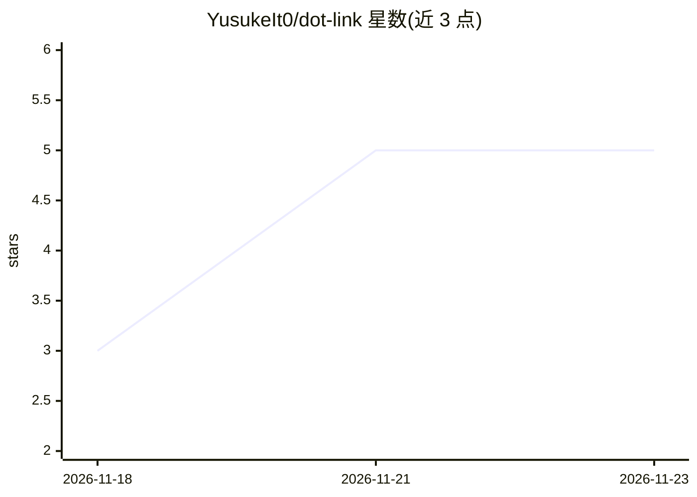

# YusukeIt0/dot-link

⭐ 5 · TypeScript · MIT · 推送 2026-11-22 · [GitHub](https://github.com/YusukeIt0/dot-link) · [官网](https://yusukeit0.github.io/dot-link/) · 个人维护

**把 ChatGPT Dot 接入 Even G2 智能眼镜的 Mac 中继应用**

开源的 Even Hub 应用加 Mac 中继程序：将用户已有的 ChatGPT Dot 与 Even Realities G2 眼镜连接，向 Dot 共享位置、步行路线、地形、近期地点、天气及 Polar 健康数据等现实上下文，使 Dot 能基于环境主动或按需回复。语音经本地 Whisper 或外部服务转录，历史记录保留期可在 Mac 端按来源分别设置。开发者服务器不经手对话与上下文。要求 Apple Silicon Mac、iPhone、含 Dot 的 ChatGPT 账号及 Tailscale。

## 筛选速览

| 维度 | 判定 | 备注 |
|---|---|---|
| AI 角色 | `ai-ecosystem` | LLM/agent 周边工具 |
| 许可风险 | `permissive` | MIT |
| 部署形态 | `None` |  |
| 模型依赖 | — | README 未给出锁定关系 |
| 硬件要求 | — | 无带数字的原话,不猜 |
| 安装摩擦 | `medium` | 含编译或系统依赖之一 |
| 成熟度 | — | 结构信号不足 |

## 能力要点

- 通过 OpenAI Secure MCP Tunnel 与自定义 MCP 连接接入已有 Dot
- 可分别开关的位置/路线/地形/近期地点/天气/健康共享控制
- 本地 Whisper 语音转录，另支持外部语音识别服务
- 支持 7 种界面语言与自定义唤醒词

## 适用场景

- 在 G2 眼镜上让 Dot 基于当前位置介绍周边地标
- 行走途中向 Dot 询问目的地步行路线与坡度信息
- 结合 Polar 睡眠与活动数据获得上下文建议

## 场景标签

`语音识别` `AI 助手` · 领域:对话与助手

## 证据(README 行号)

> L83: - **ChatGPT with Dot**, with access to an OpenAI Secure MCP Tunnel and custom MCP connections. Installing Dot Link 
> L100: 1. In the Mac app, follow **Connect your existing Dot**: create a tunnel, enter its **Tunnel ID** and **API key**,
> L135: MIT. Dependencies retain their own licenses. Dot Link is independent of OpenAI, Even Realities and Tailscale.

## 星数曲线

2026-11-18 3 → 2026-11-23 5（+2）

---
*卡片 v1 · prompt 1.4 · 生成 2026-11-21 · 置信度 high · 依据 README sha `09aae995efb6` · [字段定义](../../DATASET.md)*
