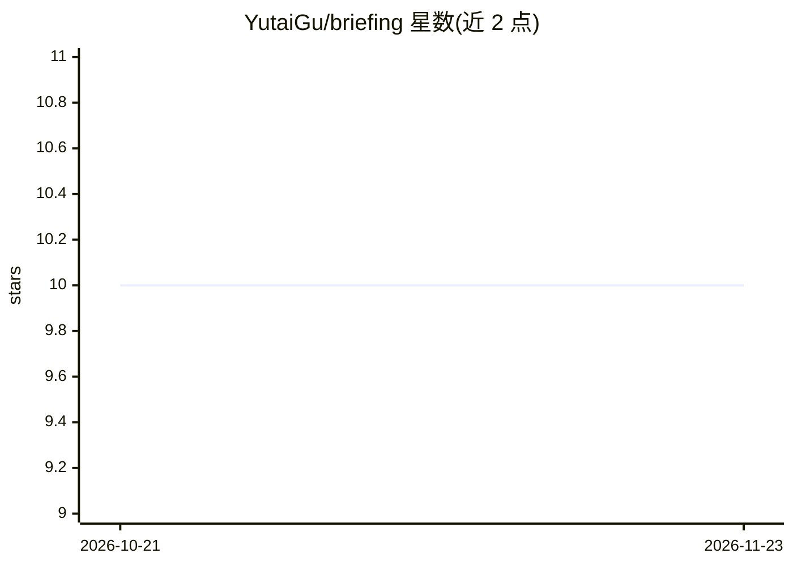

# YutaiGu/briefing

⭐ 10 · Python · MIT · 推送 2026-11-07 · [GitHub](https://github.com/YutaiGu/briefing) · 个人维护 · 中文 README

**自动追踪多平台创作者新视频并生成精炼简报的后端服务**

后端服务周期性检查所关注创作者是否发布新视频，自动执行下载→转写→内容提炼流程，将结构化摘要报告投递到配置的接收端（浏览器阅读界面、终端或 ntfy 通知）。支持 YouTube、Bilibili、TikTok、抖音四个平台的自动追踪，直播录制需借助外部工具；音频文件放入指定目录即可被自动检测处理。摘要代理根据用户在报告上的批注反馈学习调整。可通过 Releases 下载安装包运行，开发者可从源码构建，LLM API 配置为必需项。

## 筛选速览

| 维度 | 判定 | 备注 |
|---|---|---|
| AI 角色 | `ai-native` | 本体是模型或模型工具 |
| 许可风险 | `permissive` | MIT |
| 部署形态 | `desktop` | 安装包/桌面程序 |
| 模型依赖 | — | README 未给出锁定关系 |
| 硬件要求 | — | 无带数字的原话,不猜 |
| 安装摩擦 | `low` | 无编译、无系统依赖或容器化 |
| 成熟度 | — | 结构信号不足 |

## 能力要点

- 支持 YouTube/Bilibili/TikTok/抖音四平台自动追踪与下载→转写→提炼流程
- 摘要代理从用户批注反馈中学习，形成自我演进的摘要风格
- 兼容外部下载器：音频放入指定目录即被自动检测处理
- 自动读取并合并已登录浏览器（Safari/Edge/Firefox/Chrome）的 cookies

## 适用场景

- 追踪多位创作者的视频内容，快速掌握其核心观点
- 用 ntfy 在移动端接收新视频的摘要简报
- 通过批注反馈让摘要逐渐贴合个人偏好

## 场景标签

`语音识别` `工作流自动化` · 领域:效率与自动化

## 证据(README 行号)

> L25: The system periodically checks whether specified creators have released new videos, automatically performs **downlo
> L56: Leave a quick note on any report and the summary agent **learns from your feedback**, getting closer to how you lik

## 星数曲线

2026-10-21 10 → 2026-11-23 10（+0）

---
*卡片 v1 · prompt 1.4 · 生成 2026-11-20 · 置信度 high · 依据 README sha `024278177ea7` · [字段定义](../../DATASET.md)*
