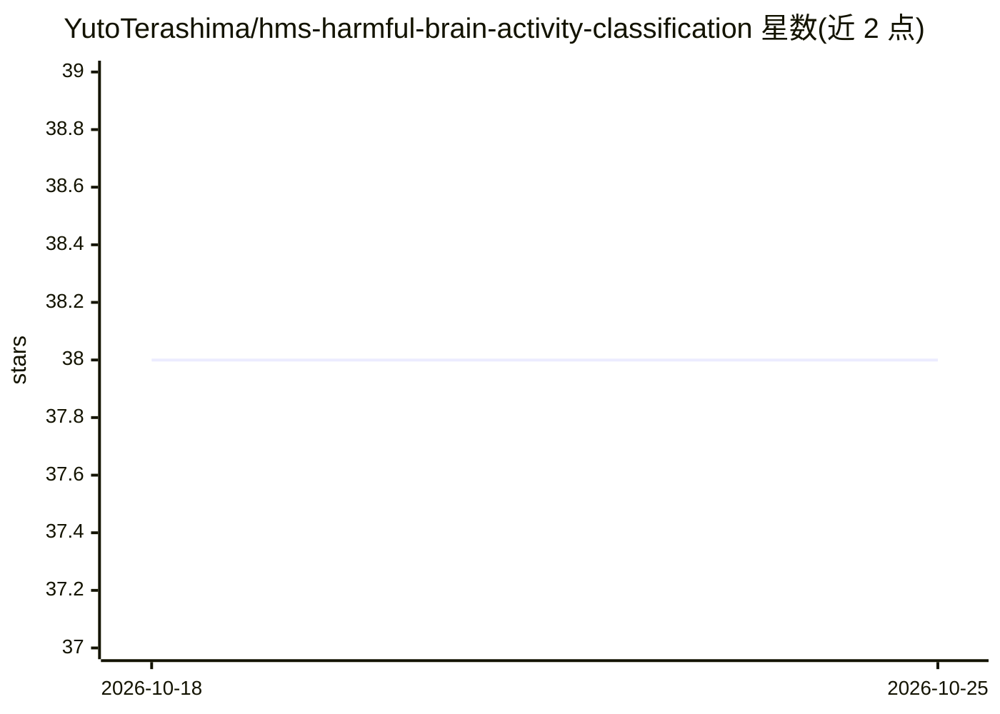

# YutoTerashima/hms-harmful-brain-activity-classification

⭐ 38 · Jupyter Notebook · MIT · 推送 2026-05-02 · [GitHub](https://github.com/YutoTerashima/hms-harmful-brain-activity-classification) · 个人维护

**HMS 脑电有害活动分类竞赛银牌方案的可复现归档**

Kaggle HMS 有害脑电活动分类竞赛（第123/2767名，银牌）的解决方案归档与可复现工程包。方案组合三个模型：基于官方与生成频谱图的 EfficientNet-B0 风格 2D CNN、处理原始 EEG 波形的 ResNet1D+GRU、仅用官方频谱图的辅助 CNN，加权融合概率输出。仓库保留 9 个原始 Kaggle notebook，并提供可复用代码库、CLI 脚本、配置、报告与冒烟测试。原始数据与模型检查点不入库，需 Kaggle 凭据下载。

## 筛选速览

| 维度 | 判定 | 备注 |
|---|---|---|
| AI 角色 | `ai-native` | 本体是模型或模型工具 |
| 许可风险 | `permissive` | MIT |
| 部署形态 | `library` | 以包/库形式分发 |
| 模型依赖 | — | README 未给出锁定关系 |
| 硬件要求 | — | 无带数字的原话,不猜 |
| 安装摩擦 | `medium` | 含编译或系统依赖之一 |
| 成熟度 | — | 结构信号不足 |

## 能力要点

- 三模型（EfficientNet 频谱图 / ResNet1D-GRU 原始波形 / 辅助 CNN）加权融合
- 保留 9 个原始 Kaggle notebook 提交归档
- 提供 CLI 脚本覆盖下载、训练、推理、融合全流程
- 含合成数据冒烟测试与二轮审查产物（notebook 指标/提交健全性/复现就绪度）

## 适用场景

- 复现或学习 HMS 脑电分类竞赛的银牌方案
- 参考 EEG 频谱图与时序模型融合的做法
- 基于现有代码扩展医疗 EEG 分类实验

## 场景标签

 · 领域:医疗AI/脑电分类

## 证据(README 行号)

> L13: The competition asks models to classify harmful brain activity patterns from EEG data collected in
> L16: computer vision models with a raw EEG sequence model, then blends the models to produce calibrated

## 星数曲线

2026-10-18 38 → 2026-10-25 38（+0）

---
*卡片 v1 · prompt 1.4 · 生成 2026-10-25 · 置信度 high · 依据 README sha `8ede784aa797` · [字段定义](../../DATASET.md)*
