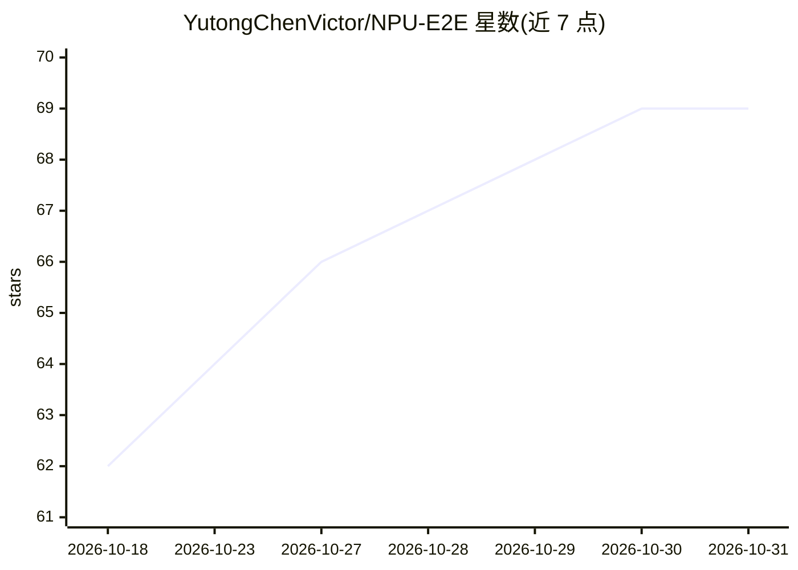

# YutongChenVictor/NPU-E2E

⭐ 69 · Verilog · AGPL-3.0 · 推送 2026-07-29 · [GitHub](https://github.com/YutongChenVictor/NPU-E2E) · 个人维护

**教学用全栈 NPU 加速器演示：RTL 到 FPGA 推理端到端**

面向学习者的 NPU 加速器端到端工程：包含 16×16 Weight-Stationary 脉动阵列 Verilog RTL（PE、双缓冲、累加器）、AXI4 SoC 集成（DMA、UART 桥、寄存器堆）、C 裸机 GEMM 运行时与 Python 串口驱动，以及 TVM BYOC 编译后端。17 个 testbench 在 iverilog 仿真通过，并在 Xilinx Zynq UltraScale+ XCZU4EV 开发板以 175 MHz 实测验证，LeNet-5 推理端到端延迟 5.1 ms（PCIe/以太网）。协议采用 AGPLv3。

## 筛选速览

| 维度 | 判定 | 备注 |
|---|---|---|
| AI 角色 | `ai-ecosystem` | LLM/agent 周边工具 |
| 许可风险 | `viral` | AGPL-3.0 |
| 部署形态 | `None` |  |
| 模型依赖 | — | README 未给出锁定关系 |
| 硬件要求 | — | 无带数字的原话,不猜 |
| 安装摩擦 | `low` | 无编译、无系统依赖或容器化 |
| 成熟度 | — | 结构信号不足 |

## 能力要点

- 16×16 脉动阵列 RTL + AXI4 SoC 集成，17 个 testbench 仿真通过
- TVM BYOC 后端：Relax IR → FuseOpsByPattern → npu_gemm() 调用
- XCZU4EV FPGA 实板验证，175 MHz，89.6 GOPS，21.3 GMAC/s/W
- LeNet-5 硬件实测端到端延迟 5.1 ms（PCIe/ETH）

## 适用场景

- 学习 NPU 从 RTL 到编译器的全栈设计流程
- 在 Zynq UltraScale+ 板上运行 INT8 神经网络推理实验
- 参考 TVM BYOC 自定义硬件后端的实现方式

## 场景标签

`教程课程` · 领域:学习与行业

## 证据(README 行号)

> L5: An educational full-stack NPU accelerator demo: end-to-end from 16×16 systolic array RTL design, AXI4 SoC integratio
> L91: - **TVM Backend**: Relax IR → `FuseOpsByPattern` → `npu_gemm()` calls — full BYOC pipeline verified on hardware

## 星数曲线

2026-10-18 62 → 2026-10-31 69（+7）

---
*卡片 v1 · prompt 1.4 · 生成 2026-10-24 · 置信度 high · 依据 README sha `6bb66db8b3b6` · [字段定义](../../DATASET.md)*
