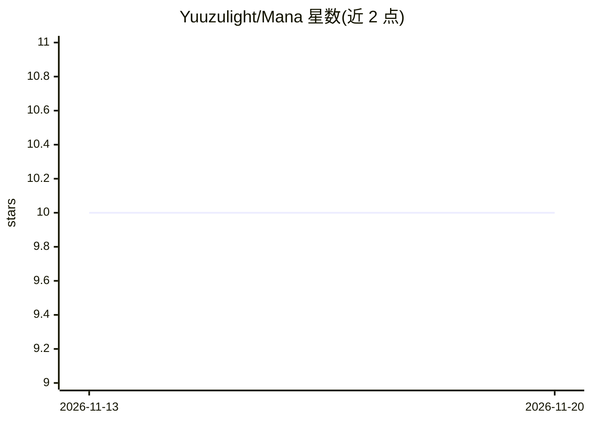

# Yuuzulight/Mana

⭐ 10 · JavaScript · Apache-2.0 · 推送 2026-11-15 · [GitHub](https://github.com/Yuuzulight/Mana) · 个人维护

**Windows 本地优先 AI 桌面伴侣：语音+Live2D 全程不离机**

面向 Windows 的本地优先 AI 伴侣应用：本地 Whisper 转录、本地 llama.cpp 生成回复、本地 TTS（默认 Fish Speech）、本地 OCR 屏幕感知与跨会话记忆，默认忽略 OPENAI_API_KEY，仅显式开启远程 AI 才外发。前端为 .NET 10 WinForms 原生启动器（Electron 版已退役）与 Node 后端，支持 Live2D/VRM 头像、语音打断、唤醒词、Zed/VS Code 编辑器集成与 OpenAI 兼容 API。个人项目，为单一 Windows 环境而建，完整安装尚未普遍化。

## 筛选速览

| 维度 | 判定 | 备注 |
|---|---|---|
| AI 角色 | `ai-native` | 本体是模型或模型工具 |
| 许可风险 | `permissive` | Apache-2.0 |
| 部署形态 | `library` | 以包/库形式分发 |
| 模型依赖 | local-ok | 支持本地模型 |
| 硬件要求 | — | 无带数字的原话,不猜 |
| 安装摩擦 | `medium` | 含编译或系统依赖之一 |
| 成熟度 | `idea` | |

## 能力要点

- 本地语音闭环：whisper.cpp 转录 + llama.cpp 回复 + 本地 TTS（Fish Speech 默认）
- 屏幕感知：本地 OCR 读取屏幕文本，Ctrl+Alt+Shift+M 描述屏幕
- Live2D/VRM 头像带唇形同步与情绪反应，支持语音打断与唤醒词
- OpenAI 兼容 API（/v1/chat/completions 等）供外部工具接入本地后端

## 适用场景

- 在桌面有一个常驻倾听、不带月费且数据不出机的语音助手
- 离线环境下进行语音对话与屏幕内容问答
- 让 AI 伴侣以 Live2D 形象出现在桌面并联动游戏模式

## 场景标签

`AI 助手` `语音 Agent` · 领域:对话与助手

## 证据(README 行号)

> L3:  A local-first AI companion for Windows — she listens, thinks, remembers, and talks back without your voice or your 
> L37: - 🔒 **Privacy-first, not privacy-optional** — local `llama.cpp` replies, local Whisper transcription, local TTS, an
> L80: - **Local AI by default**: Mana uses local `llama.cpp` models unless remote AI is explicitly enabled. See Model Sta

## 星数曲线

2026-11-13 10 → 2026-11-20 10（+0）

---
*卡片 v1 · prompt 1.4 · 生成 2026-11-20 · 置信度 high · 依据 README sha `17ce51017568` · [字段定义](../../DATASET.md)*
