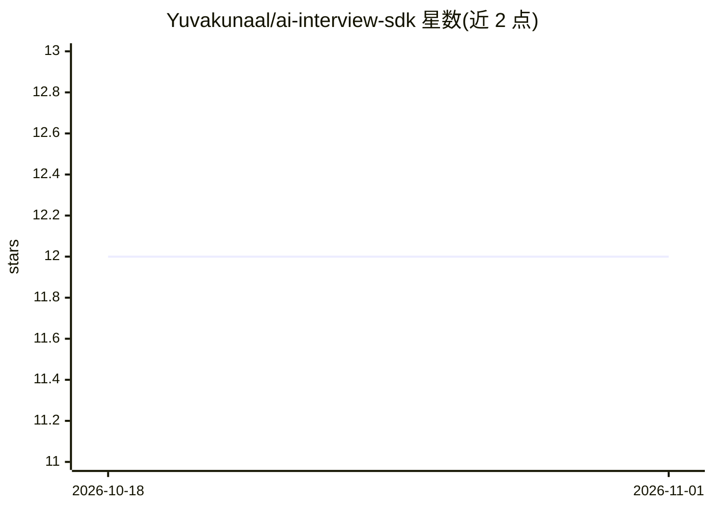

# Yuvakunaal/ai-interview-sdk

⭐ 12 · TypeScript · MIT · 推送 2026-09-01 · [GitHub](https://github.com/Yuvakunaal/ai-interview-sdk) · [官网](https://ai-interview-sdk.vercel.app) · 个人维护

**将 AI 面试组件嵌入自家应用的 TypeScript/React SDK**

面向开发者的开源 SDK：以一个 React 组件提供 AI 面试流程，含动态追问引擎、语义评估、rubric 评分、语音输入与报告生成。支持 Client 模式（浏览器直连，自备 API key）与 Server 模式（连接自有后端，HMAC 签名防篡改评分），维护方不运行任何后端服务、不接触候选人数据。提供 OpenAI/Claude/Gemini/Deepgram/ElevenLabs 五个 provider 适配器与自动故障切换，另有 CLI、本地 Dashboard、偏见测试工具与沙箱代码执行评分包。需 Node >= 20.19，MIT 许可。

## 筛选速览

| 维度 | 判定 | 备注 |
|---|---|---|
| AI 角色 | `ai-ecosystem` | LLM/agent 周边工具 |
| 许可风险 | `permissive` | MIT |
| 部署形态 | `library` | 以包/库形式分发 |
| 模型依赖 | locked-api |  |
| 硬件要求 | — | 无带数字的原话,不猜 |
| 安装摩擦 | `low` | 无编译、无系统依赖或容器化 |
| 成熟度 | — | 结构信号不足 |

## 能力要点

- 单个 React 组件提供完整面试流程（动态追问、语义评估、rubric 评分、报告）
- Client/Server 双模式，Server 模式 HMAC 签名防篡改评分
- 五个 provider 适配器（OpenAI/Claude/Gemini/Deepgram/ElevenLabs）与自动故障切换
- 维护方零后端服务，候选人数据不经维护方处理

## 适用场景

- 在自家产品中嵌入 AI 评分面试功能并保留数据控制权
- 用生产模式将面试评分部署到自有后端与 API key
- 用偏见测试工具在真实候选人前验证评分一致性

## 场景标签

 · 领域:招聘/HR 技术

## 证据(README 行号)

> L12: **Drop an AI-scored interview into your own product as one React component —
> L58: - **Five real provider adapters** (OpenAI, Claude, Gemini, Deepgram,
> L100: |`@interview-sdk/adapter-openai`|npm|OpenAI provider adapter|

## 星数曲线

2026-10-18 12 → 2026-11-01 12（+0）

---
*卡片 v1 · prompt 1.4 · 生成 2026-11-01 · 置信度 high · 依据 README sha `d4cc9cadc459` · [字段定义](../../DATASET.md)*
