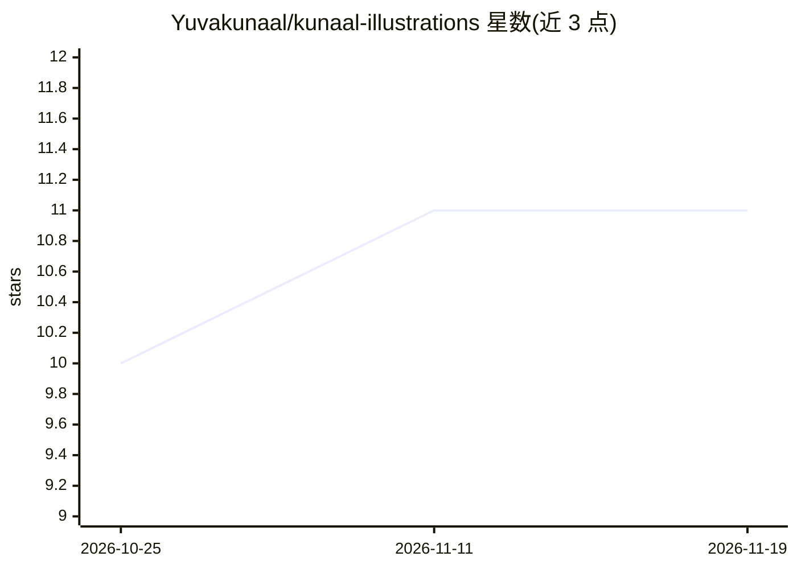

# Yuvakunaal/kunaal-illustrations

⭐ 11 · MIT · 推送 2026-06-25 · [GitHub](https://github.com/Yuvakunaal/kunaal-illustrations) · [官网](https://kunaal-portfolio.vercel.app/) · 个人维护

**让 AI agent 为英文文章生成手绘风格插图的技术**

一个指导 AI agent 生成文章插图的 Skill 仓库：agent 读取 SKILL.md 与 references 中的风格规则、角色 IP、构图模式与提示词模板后，从英文文章/博客/Notion 内容中提取观点、流程与比喻，先输出 4-8 张图的 shot list，再调用图像模型逐张生成 PNG 并保存到 Generated/ 文件夹。默认使用 Antigravity + Gemini 模型。输出为宽构图、纯白背景、黑白抖动线条、红橙蓝英文标注的手绘图；不产出 PPT/SVG/矢量文件。

## 筛选速览

| 维度 | 判定 | 备注 |
|---|---|---|
| AI 角色 | `ai-native` | 本体是模型或模型工具 |
| 许可风险 | `permissive` | MIT |
| 部署形态 | `None` |  |
| 模型依赖 | — | README 未给出锁定关系 |
| 硬件要求 | — | 无带数字的原话,不猜 |
| 安装摩擦 | `low` | 无编译、无系统依赖或容器化 |
| 成熟度 | — | 结构信号不足 |

## 能力要点

- Boy & Girl 两个固定角色 IP 参与每张图的核心动作
- 工作流含 shot list 规划、8 种结构类型选择与 QA 检查清单
- 生成图片自动保存到工作区 Generated/ 文件夹
- 支持仅做插图规划而不生成图片的用法

## 适用场景

- 为英文文章和博客批量生成文中插图
- 把抽象观点画成具体的视觉比喻
- 为知识类/方法论内容维持一致的视觉语言

## 场景标签

`图像生成` · 领域:内容生成

## 证据(README 行号)

> L39: Kunaal's Illustrations is a Skill used to guide AI Agents to generate in-text illustrations for English articles, p
> L20: ## ⚡ Quick Start (use only Antigravity with Gemini model to get most accurate images)

## 星数曲线

2026-10-25 10 → 2026-11-19 11（+1）

---
*卡片 v1 · prompt 1.4 · 生成 2026-11-18 · 置信度 high · 依据 README sha `96061932784c` · [字段定义](../../DATASET.md)*
