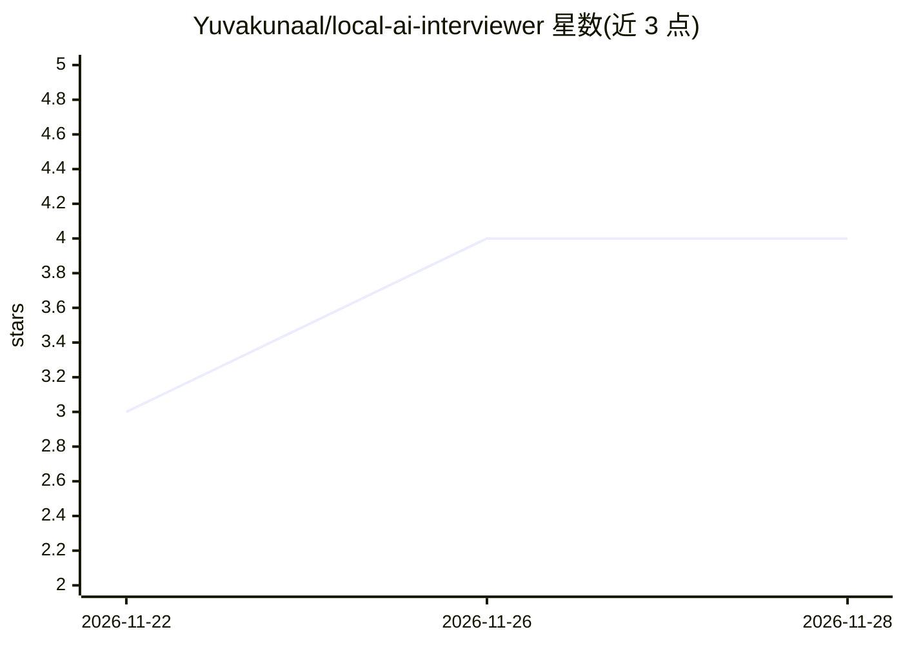

# Yuvakunaal/local-ai-interviewer

⭐ 4 · Python · MIT · 推送 2026-11-24 · [GitHub](https://github.com/Yuvakunaal/local-ai-interviewer) · 个人维护

**在本机隐私运行、由本地 LLM 评分的求职模拟面试应用**

面向技术岗位求职者的模拟面试应用：朗读问题、接收打字或语音回答、按策略自适应追问，最后给出带评分的报告。评分机制要求 AI 引用原话作为依据，无法引用的指控标记为 unverified 且不计入错误。默认通过 Ollama 在本机运行模型（qwen3.5:4b），无账号无遥测；无足够硬件时可改用免费的 Groq 云端评分。提供离线 Whisper 语音、简历解析生成问题、进度仪表盘与 PDF/Markdown/JSON 导出。

## 筛选速览

| 维度 | 判定 | 备注 |
|---|---|---|
| AI 角色 | `ai-native` | 本体是模型或模型工具 |
| 许可风险 | `permissive` | MIT |
| 部署形态 | `desktop` | 安装包/桌面程序 |
| 模型依赖 | local-ok | 支持本地模型 |
| 硬件要求 | — | 无带数字的原话,不猜 |
| 安装摩擦 | `low` | 无编译、无系统依赖或容器化 |
| 成熟度 | — | 结构信号不足 |

## 能力要点

- 证据核对式评分：错误必须引用原话，否则不计入
- 默认经 Ollama 本机推理，答案不出本机，可选 Groq 云端模式
- 六种自适应面试策略与简历逐行核对生成问题
- 离线 Whisper 语音回答与系统语音朗读问题

## 适用场景

- 为软件/数据/云/安全等技术岗位做私下模拟面试
- 上传简历让面试题针对自己的项目经历
- 在无 GPU 或内存有限的笔记本上练习并评分
- 离线环境下完整完成语音问答与评分报告

## 场景标签

`语音识别` · 领域:感知与多模态

## 证据(README 行号)

> L5: **Private mock interviews for tech roles, graded by a local LLM on your own computer.**
> L22: * **Graded with evidence.** The grader has to quote your own words for every mistake it claims. A mistake it cannot

## 星数曲线

2026-11-22 3 → 2026-11-28 4（+1）

---
*卡片 v1 · prompt 1.4 · 生成 2026-11-22 · 置信度 mid · 依据 README sha `d7c690f750d0` · [字段定义](../../DATASET.md)*
