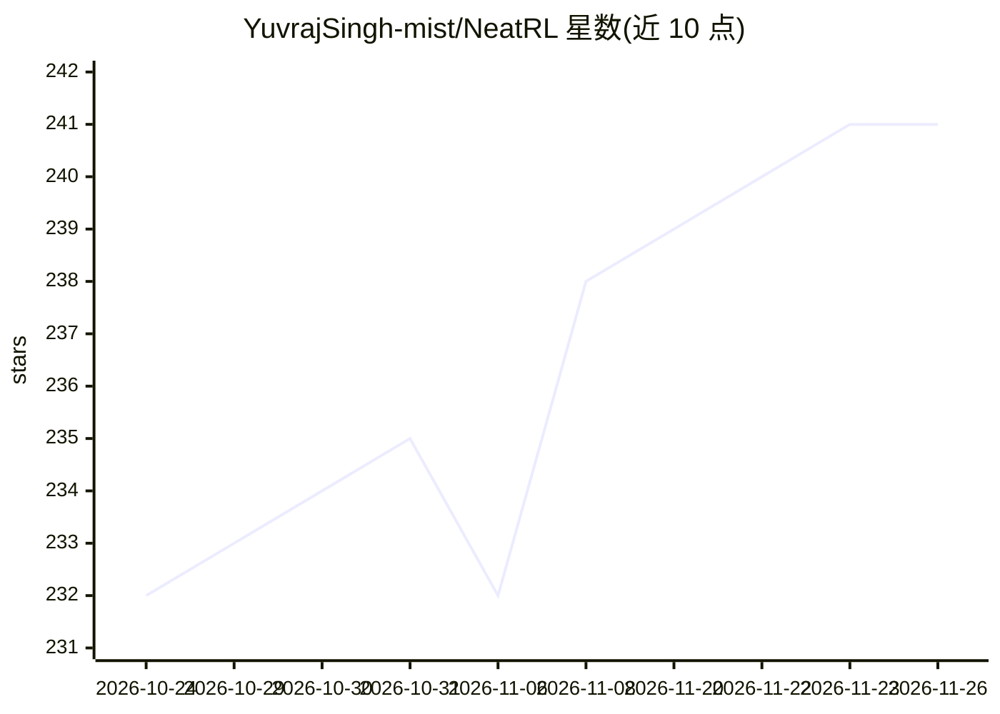

# YuvrajSingh-mist/NeatRL

⭐ 241 · Python · Apache-2.0 · 推送 2026-11-25 · [GitHub](https://github.com/YuvrajSingh-mist/NeatRL) · [官网](https://www.neatrl.com) · 个人维护

**面向研究者/学习者的单文件 PyTorch 强化学习算法库**

以 PyTorch 实现的强化学习算法库，每个算法（DQN、PPO、SAC、TD3、DDPG、A2C、REINFORCE、RND、Q-learning 等 21 个 CLI 别名）集中在单个自包含文件中，可通过 Python API 训练或经 neatrl CLI 命令行训练。兼容 Gymnasium 环境，支持 Atari（自动 CNN 架构）、Box2D、MuJoCo、Classic Control，内置 Weights & Biases 实验跟踪、向量化并行环境与视频录制；-cnn 别名需安装对应环境 extra。Apache 2.0（代码）+ CC BY 4.0（文档/数据）双许可声明的是不同内容类别而非商业版。

## 筛选速览

| 维度 | 判定 | 备注 |
|---|---|---|
| AI 角色 | `ai-native` | 本体是模型或模型工具 |
| 许可风险 | `permissive` | Apache-2.0 |
| 部署形态 | `library` | 以包/库形式分发 |
| 模型依赖 | — | README 未给出锁定关系 |
| 硬件要求 | — | 无带数字的原话,不猜 |
| 安装摩擦 | `low` | 无编译、无系统依赖或容器化 |
| 成熟度 | — | 结构信号不足 |

## 能力要点

- 每个算法单文件自包含实现，提供 21 个 CLI 训练别名
- 兼容 Gymnasium，支持 Atari/Box2D/MuJoCo/Classic Control
- 内置 Weights & Biases 实验跟踪与视频录制
- 向量化环境并行训练，本地运行、默认不上传

## 适用场景

- 学习与复现经典深度 RL 算法实现
- 在 CartPole/LunarLander/Atari 等环境上做 RL 实验
- 命令行快速训练并跟踪实验指标

## 场景标签

`强化学习` · 领域:训练与推理

## 证据(README 行号)

> L7: NeatRL provides readable implementations of popular RL algorithms with a focus on simplicity and ease of use. Built 
> L11: - **Single-file implementations**: Each algorithm lives entirely in one self-contained file -- no hunting across mo

## 星数曲线

2026-10-24 232 → 2026-11-26 241（+9）

---
*卡片 v1 · prompt 1.4 · 生成 2026-11-25 · 置信度 high · 依据 README sha `8f4b3f35994f` · [字段定义](../../DATASET.md)*
