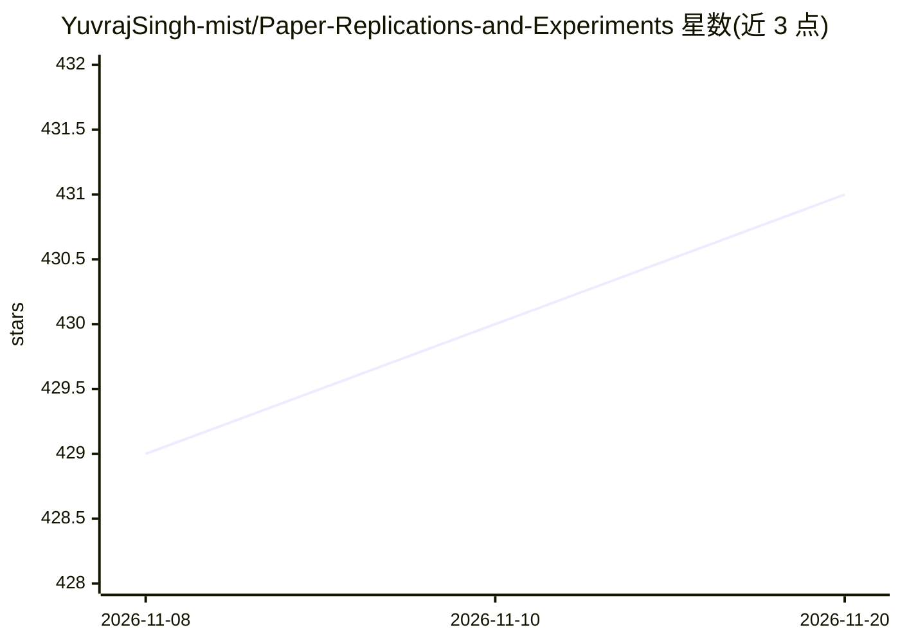

# YuvrajSingh-mist/Paper-Replications-and-Experiments

⭐ 431 · Jupyter Notebook · Apache-2.0 · 推送 2026-11-04 · [GitHub](https://github.com/YuvrajSingh-mist/Paper-Replications-and-Experiments) · [官网](https://www.smolhub.com/) · 个人维护

**从零复现 AI/ML 论文的 PyTorch 代码与训练实验合集**

个人维护的论文复现仓库：37 篇论文（Bahdanau 注意力、Transformer、BERT、GPT、Llama、Mixtral、DeepSeek V3、GAN、VAE、CLIP、Whisper 等）用 PyTorch 从零重实现，每个文件夹自带记录超参数、数据集与最终损失的 README；另含 SmolHub（6 个 88M–200M 参数的自研小型语言模型及完整训练管线与 HF Space 部署）和 Post-Training（SFT/GRPO 配方与自有数据实验）。权重与检查点不入库，各文件夹独立运行。

## 筛选速览

| 维度 | 判定 | 备注 |
|---|---|---|
| AI 角色 | `ai-native` | 本体是模型或模型工具 |
| 许可风险 | `permissive` | Apache-2.0 |
| 部署形态 | `None` |  |
| 模型依赖 | — | README 未给出锁定关系 |
| 硬件要求 | — | 无带数字的原话,不猜 |
| 安装摩擦 | `low` | 无编译、无系统依赖或容器化 |
| 成熟度 | — | 结构信号不足 |

## 能力要点

- 37 篇论文从零复现，附超参数与结果 README
- 6 个自研小语言模型（88M–200M，含 MoE/MLA 架构）端到端训练
- SFT 与 GRPO 后训练配方及自有数据实验
- 部分模型权重发布于 HuggingFace Hub 并提供 Spaces 部署

## 适用场景

- 对照学习经典与 SOTA 论文的从零实现细节
- 参考小参数量语言模型的训练管线与配置
- 复用 SFT/GRPO 后训练配方做微调实验

## 场景标签

`微调` `强化学习` `教程课程` · 领域:学习与行业

## 证据(README 行号)

> L3: **From-scratch PyTorch replications of classic and SOTA AI/ML papers, small language models trained end to end, and 
> L13: |`Replications/`|**37** papers reimplemented from scratch, each self-contained with a README of hyperparameters and
> L19: One folder per paper, from Bahdanau attention and the original Transformer through BERT, GPT, Llama, Mixtral and De

## 星数曲线

2026-11-08 429 → 2026-11-20 431（+2）

---
*卡片 v1 · prompt 1.4 · 生成 2026-11-17 · 置信度 mid · 依据 README sha `14f469fa4f98` · [字段定义](../../DATASET.md)*
