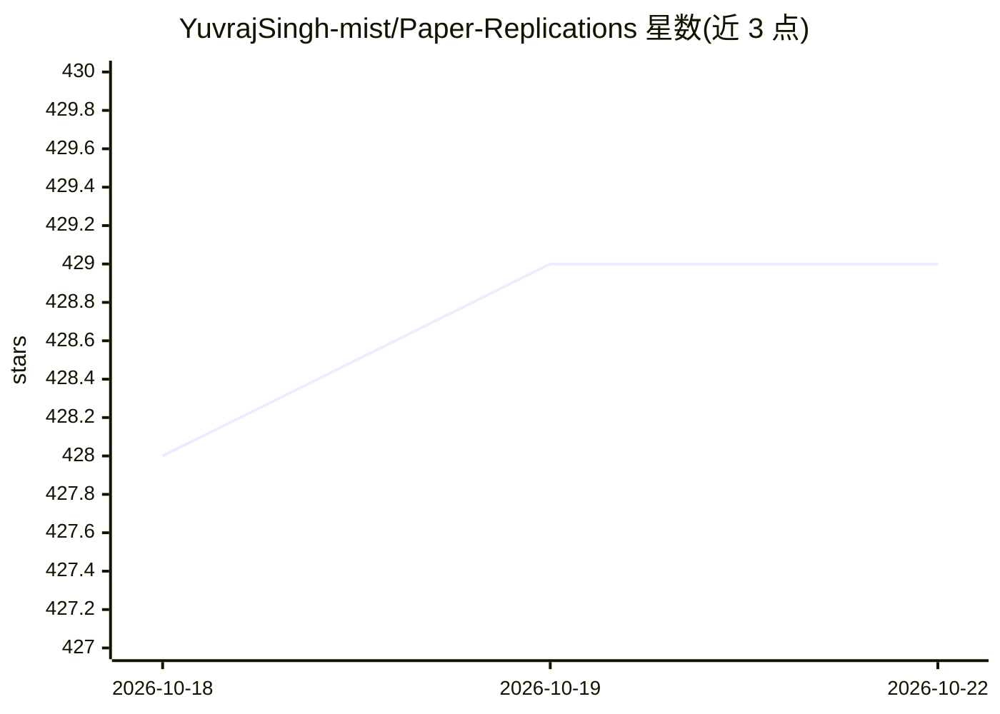

# YuvrajSingh-mist/Paper-Replications

⭐ 429 · Jupyter Notebook · Apache-2.0 · 推送 2026-10-07 · [GitHub](https://github.com/YuvrajSingh-mist/Paper-Replications) · [官网](https://www.smolhub.com/) · 个人维护

**经典与前沿 AI/ML 论文的 PyTorch 从零复现代码合集**

收录 30 余篇经典与 SOTA 机器学习论文的从零 PyTorch 实现，每个子目录对应一篇论文或一种技术，涵盖 Transformer、BERT、GPT、Llama、DeepSeek、GAN 系列（CGAN/CycleGAN/DCGAN/WGAN）、扩散模型、CLIP/SigLIP/CLAP、LoRA/PEFT、DPO/ORPO、MoE、VAE/ViT、Whisper 与 TTS 等，含训练脚本与部分笔记本，部分附带预训练权重或结果。面向学习与复现研究的开发者与科研人员，各子目录自包含，需进入对应目录查看各自 README 获取运行说明。

## 筛选速览

| 维度 | 判定 | 备注 |
|---|---|---|
| AI 角色 | `ai-knowledge` | 知识聚合/清单类 |
| 许可风险 | `permissive` | Apache-2.0 |
| 部署形态 | `None` |  |
| 模型依赖 | — | README 未给出锁定关系 |
| 硬件要求 | — | 无带数字的原话,不猜 |
| 安装摩擦 | `low` | 无编译、无系统依赖或容器化 |
| 成熟度 | — | 结构信号不足 |

## 能力要点

- 30+ 论文/模型的从零 PyTorch 实现，子目录自包含
- 覆盖注意力机制、GAN、扩散、视觉-语言、RLHF 偏好优化等方向
- 含分布式训练（DDP）实验与部分预训练权重/结果
- 代码与笔记本采用 Apache 2.0 许可

## 适用场景

- 对照论文学习模型结构与训练实现
- 复现经典论文结果并做改写实验
- 作为从零实现参考来写自己的模型代码

## 场景标签

`教程课程` · 领域:学习与行业

## 证据(README 行号)

> L3: **From-scratch PyTorch replications of classic and SOTA AI/ML papers**
> L7: This repository contains a collection of code implementations and experiments replicating results from a wide range 
> L54: Each folder is self-contained and includes code, scripts, and sometimes notebooks for replicating the results of th

## 星数曲线

2026-10-18 428 → 2026-10-22 429（+1）

---
*卡片 v1 · prompt 1.4 · 生成 2026-10-21 · 置信度 mid · 依据 README sha `79990464195f` · [字段定义](../../DATASET.md)*
