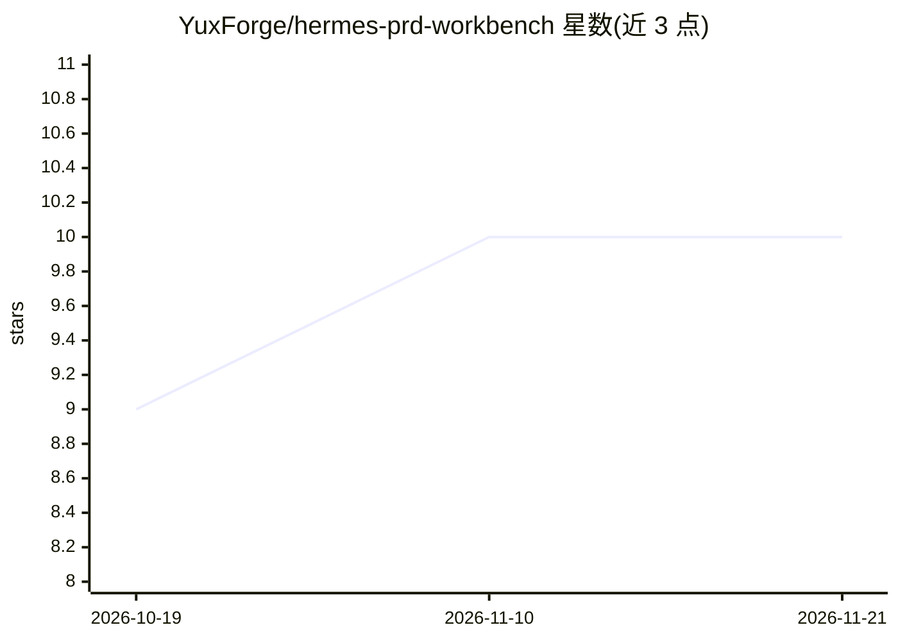

# YuxForge/hermes-prd-workbench

⭐ 10 · Java · Apache-2.0 · 推送 2026-10-22 · [GitHub](https://github.com/YuxForge/hermes-prd-workbench) · [官网](https://github.com/YuxForge/hermes-prd-workbench/releases/tag/v0.4.0-beta.2) · 个人维护 · 中文 README

**自托管工作台：把需求笔记转为 PRD、技术规格与测试用例**

面向产品与工程团队的自托管（Apache-2.0）需求工程工作区。上传原始材料后由 Hermes Agent 产出评审结论、PRD 包、单文件 HTML Demo、静态 POC 原型、测试用例 XLSX、工作量估算与技术规格文档。机制上原始 Agent 结果不可变，用户编辑与评审决策存于独立工作草稿；生成 HTML 在 iframe sandbox 中预览，不在 Node VM 执行。需自备 Chat Completions 端点与 API key，部署经 Docker Compose，当前声明支持 macOS arm64 与 Windows 11 WSL2。

## 筛选速览

| 维度 | 判定 | 备注 |
|---|---|---|
| AI 角色 | `ai-native` | 本体是模型或模型工具 |
| 许可风险 | `permissive` | Apache-2.0 |
| 部署形态 | `None` |  |
| 模型依赖 | — | README 未给出锁定关系 |
| 硬件要求 | — | 无带数字的原话,不猜 |
| 安装摩擦 | `low` | 无编译、无系统依赖或容器化 |
| 成熟度 | `idea` | |

## 能力要点

- 七种交付模式：Review/PRD/演示/POC/估算/测试用例/技术规格
- 原始 Agent 结果不可变，编辑与决策分离存储
- 生成 HTML 以 sandbox iframe 预览，不执行于 Node VM
- 失败任务仅手动重跑，无静默修复或自动重试

## 适用场景

- 把会议需求笔记整理成可评审的 PRD
- 识别需求中冲突的业务规则并记录人工决策
- 为需求生成测试计划与工作量估算交付件
- 生成可点击的静态原型做工程交接

## 场景标签

`AI 写作` `代码生成` · 领域:编码与开发

## 证据(README 行号)

> L8: > **Turn messy requirement notes into reviewable, traceable PRDs, interactive prototypes, test plans, and technical 
> L19: Hermes PRD Workbench is an Apache-2.0 self-hosted workspace for product and engineering teams. Upload source materi
> L85:                                            └──> operator-selected model endpoint

## 星数曲线

2026-10-19 9 → 2026-11-21 10（+1）

---
*卡片 v1 · prompt 1.4 · 生成 2026-11-20 · 置信度 high · 依据 README sha `e46ad582e762` · [字段定义](../../DATASET.md)*
