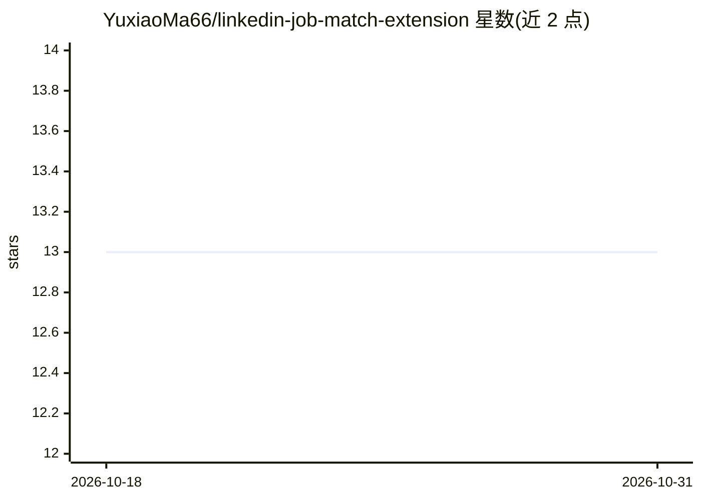

# YuxiaoMa66/linkedin-job-match-extension

⭐ 13 · JavaScript · MIT · 推送 2026-09-16 · [GitHub](https://github.com/YuxiaoMa66/linkedin-job-match-extension) · [官网](https://yuxiaoma66.github.io/linkedin-job-match-extension/docs/) · 个人维护 · 中文 README

**求职者用的本地优先简历-岗位匹配 Chrome 扩展**

Chrome Manifest V3 扩展（Vite 构建，MIT 许可），面向在 LinkedIn 与荷兰 Indeed 求职的用户：上传的简历被解析为结构化档案，与岗位描述做匹配评分，并在原页面注入匹配分与标题胶囊信号；支持单岗位分析、列表批量分析、粘贴外部岗位、历史与收藏。支持 OpenAI/Anthropic/Gemini/OpenRouter/Poe/自定义端点多供应商配置，数据存于 chrome.storage.local；含基于 IND 数据集（12,927 个组织名）的荷兰担保风险核查。安装方式为加载构建后的 dist 或发布包，不支持直接加载源码根目录。

## 筛选速览

| 维度 | 判定 | 备注 |
|---|---|---|
| AI 角色 | `ai-enhanced` | 去掉 AI 部分产品仍成立 |
| 许可风险 | `permissive` | MIT |
| 部署形态 | `library` | 以包/库形式分发 |
| 模型依赖 | locked-api |  |
| 硬件要求 | — | 无带数字的原话,不猜 |
| 安装摩擦 | `low` | 无编译、无系统依赖或容器化 |
| 成熟度 | — | 结构信号不足 |

## 能力要点

- 上传简历转为结构化档案并可多档案切换复用
- 四档证据评分模式（Strict/Balanced/Potential/Sponsorship-first）
- 六类模型供应商独立配置（OpenAI/Anthropic/Gemini/OpenRouter/Poe/Custom）
- 内置 IND 衍生的 12,927 组织名荷兰担保数据集核查

## 适用场景

- 浏览 LinkedIn/Indeed 列表时快速判断岗位与我的简历匹配度
- 在页面上直接看到匹配分、经验要求、担保标记等信号
- 粘贴其他来源的 JD 做离线/模型解析后统一分析
- 在荷兰求职时核查岗位组织的担保风险

## 场景标签

`文档解析` `AI 助手` · 领域:对话与助手

## 证据(README 行号)

> L12:  A local-first Chrome extension for resume matching, reusable job analysis, inline LinkedIn and Indeed signals, and
> L71: |Provider choice|Supports OpenAI, Anthropic, Gemini, OpenRouter, Poe, and custom OpenAI-compatible endpoints.|

## 星数曲线

2026-10-18 13 → 2026-10-31 13（+0）

---
*卡片 v1 · prompt 1.4 · 生成 2026-10-31 · 置信度 mid · 依据 README sha `40c96897b365` · [字段定义](../../DATASET.md)*
