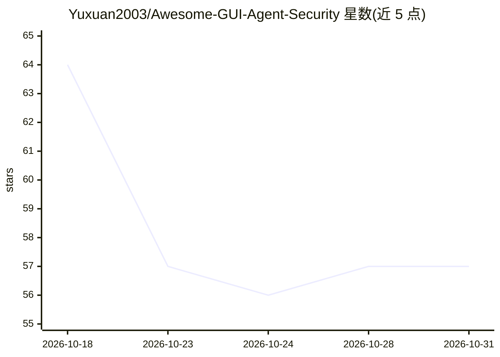

# Yuxuan2003/Awesome-GUI-Agent-Security

⭐ 57 · Python · MIT · 推送 2026-10-21 · [GitHub](https://github.com/Yuxuan2003/Awesome-GUI-Agent-Security) · 个人维护 · 中文 README

**GUI/Computer-Use/Browser Agent 安全论文策展清单，按攻防轴组织**

论文清单类仓库：收录以 GUI、computer-use、browser、mobile agent 为主要研究对象且含安全贡献的论文，按攻击面（间接提示注入、视觉层攻击、环境注入、提权、数据外泄、后门投毒、良性指令的意外危害）与防御层（如输入过滤）两级组织，而非按运行环境分类；首页为每篇一行的索引，各章节链接到含 3-5 句中文简介的分页。明确排除仅以 GUI agent 为测试床的一般 LLM 安全工作、面向安全任务的 agent 及纯能力工作。面向安全研究者与 agent 开发者。

## 筛选速览

| 维度 | 判定 | 备注 |
|---|---|---|
| AI 角色 | `ai-knowledge` | 知识聚合/清单类 |
| 许可风险 | `permissive` | MIT |
| 部署形态 | `None` |  |
| 模型依赖 | — | README 未给出锁定关系 |
| 硬件要求 | — | 无带数字的原话,不猜 |
| 安装摩擦 | `low` | 无编译、无系统依赖或容器化 |
| 成熟度 | — | 结构信号不足 |

## 能力要点

- 按攻击向量与防御干预点组织，运行环境作为横切标签
- 首页为单行索引，分页附 3-5 句中文简介
- 明确收录范围：以 GUI/computer-use/browser/mobile agent 为主体且含安全贡献
- 覆盖 Surveys/Threat Models、7 类攻击面与防御层章节

## 适用场景

- 查找 GUI/computer-use agent 特定攻击向量的相关论文
- 调研 agent 安全的防御层与干预点
- 跟踪间接提示注入、视觉层攻击等方向的新论文

## 场景标签

`精选清单` · 领域:学习与行业

## 证据(README 行号)

> L5: > A curated list of papers on GUI / Computer-Use / Browser Agent security — organized by attack surface and defense 
> L11: > **Scope:** papers whose *primary subject* is a GUI / computer-use / browser / mobile agent, with a security contr

## 星数曲线

2026-10-18 64 → 2026-10-31 57（-7）

---
*卡片 v1 · prompt 1.4 · 生成 2026-10-24 · 置信度 high · 依据 README sha `2004d47e3b65` · [字段定义](../../DATASET.md)*
