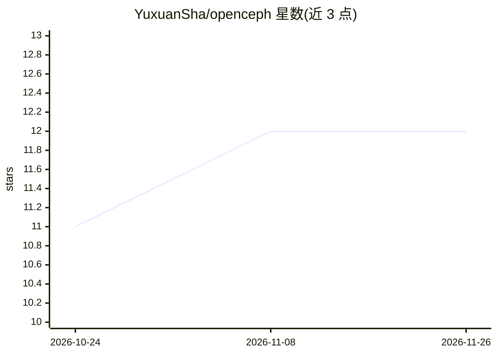

# YuxuanSha/openceph

⭐ 12 · TypeScript · MIT · 推送 2026-04-02 · [GitHub](https://github.com/YuxuanSha/openceph) · [官网](https://www.openceph.com/) · 个人维护 · 中文 README

**在个人设备上运行的主动式 AI 个人操作系统**

OpenCeph 是运行在本地设备上的主动式 AI 个人助手系统：以「触手（tentacle）」子进程 24/7 监控数据源，经 Daemon（规则抓取）→ Agent（LLM 分析）→ Consultation（Brain 复核）三层处理，仅在必要时通过 Telegram/飞书/WebChat/CLI 推送。Brain 基于 Pi 框架，支持 16+ 类工具、SQLite FTS5 长期记忆、心跳与定时任务、SKILL.md 技能扩展与 MCP 桥接。运行需 Node ≥22，凭据本地存储于权限 600 的文件中。

## 筛选速览

| 维度 | 判定 | 备注 |
|---|---|---|
| AI 角色 | `ai-native` | 本体是模型或模型工具 |
| 许可风险 | `permissive` | MIT |
| 部署形态 | `library` | 以包/库形式分发 |
| 模型依赖 | locked-api |  |
| 硬件要求 | — | 无带数字的原话,不猜 |
| 安装摩擦 | `low` | 无编译、无系统依赖或容器化 |
| 成熟度 | — | 结构信号不足 |

## 能力要点

- 三层触手架构（daemon/agent/consultation）与健康状况评分自动启停
- MEMORY.md + SQLite FTS5 的长期记忆与蒸馏机制
- Telegram/飞书/WebChat/CLI 四通道网关与 DM pairing 访问控制
- SKILL.md 技能自动转为触手，支持 Python/TypeScript/Go/Shell

## 适用场景

- 让 AI 持续监控 Hacker News、ArXiv 等信息源并只在重要时推送
- 通过 Telegram/飞书与个人助手对话并管理定时任务
- 为自建数据监控任务编写触手技能扩展系统

## 场景标签

`AI 助手` · 领域:对话与助手

## 证据(README 行号)

> L11: **OpenCeph** is a _proactive AI personal operating system_ that runs on your own devices. Unlike traditional AI ass
> L17: - **Proactive, not reactive** — Tentacles run 24/7 monitoring, analyzing, and filtering. You get push notifications
> L19: - **Autonomous Tentacles** — Independent agent subprocesses with a three-layer architecture: daemon (data fetching)

## 星数曲线

2026-10-24 11 → 2026-11-26 12（+1）

---
*卡片 v1 · prompt 1.4 · 生成 2026-11-18 · 置信度 high · 依据 README sha `12717144701b` · [字段定义](../../DATASET.md)*
