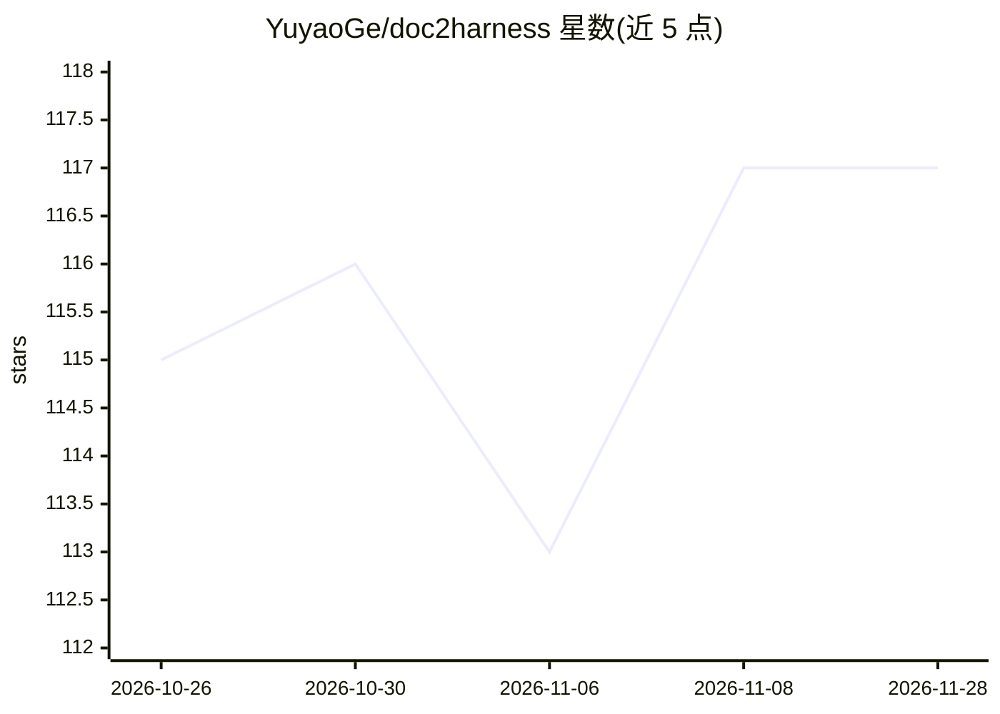

# YuyaoGe/doc2harness

⭐ 117 · Python · NOASSERTION · 推送 2026-10-27 · [GitHub](https://github.com/YuyaoGe/doc2harness) · [官网](https://geyuyao.com/doc2harness/) · 个人维护

**评测 LLM 构建编码 agent harness 能力的基准**

Doc2Harness 是论文配套基准，衡量模型能否从开发文档和接口骨架出发构建出可工作的编码 agent harness，而非在单个任务内写补丁。流程分两阶段：Stage 1 由 build model 经 OpenCode 在隔离容器内实现完整 harness；Stage 2 将冻结的 harness 放入独立容器，由脚本化 mock model 驱动端到端运行，读取请求、文件、退出码、命令输出四个通道，并用 positive controls 排除空洞通过。本仓库为部分开源（94/328 场景），仅用 Python 标准库，需 Docker。

## 筛选速览

| 维度 | 判定 | 备注 |
|---|---|---|
| AI 角色 | `ai-ecosystem` | LLM/agent 周边工具 |
| 许可风险 | `none` | NOASSERTION |
| 部署形态 | `self-host` | docker 或自建部署 |
| 模型依赖 | — | README 未给出锁定关系 |
| 硬件要求 | — | 无带数字的原话,不猜 |
| 安装摩擦 | `low` | 无编译、无系统依赖或容器化 |
| 成熟度 | `idea` | |

## 能力要点

- 两阶段管线：容器内构建 harness + mock model 端到端评分
- 读取四个可观测通道，positive controls 排除空洞通过
- 94 个场景分 9 个家族（file/permission/state/tui 等），加载时校验目录摘要
- 纯标准库实现，无需第三方 Python 包

## 适用场景

- 测量模型长程构建编码 agent 工具的能力
- 对现有 agent 产品跑场景目录出分
- 复现论文基准的开放子集

## 场景标签

`模型评测` · 领域:评测与运维

## 证据(README 行号)

> L22: Doc2Harness measures how well a model can **build a working coding agent** —
> L29: - 🔬 **Stage 2 — Evaluate.** The harness is frozen, moved to a separate
> L56: **Requirements:** Python 3.11+ and Docker. No third-party Python packages —

## 星数曲线

2026-10-26 115 → 2026-11-28 117（+2）

---
*卡片 v1 · prompt 1.4 · 生成 2026-11-28 · 置信度 high · 依据 README sha `cf40c09b2d12` · [字段定义](../../DATASET.md)*
