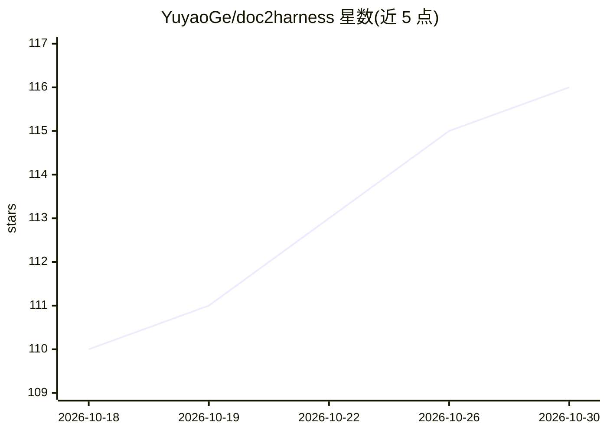

# YuyaoGe/doc2harness

⭐ 116 · Python · NOASSERTION · 推送 2026-10-27 · [GitHub](https://github.com/YuyaoGe/doc2harness) · [官网](https://geyuyao.com/doc2harness/) · 个人维护

**评测 LLM 能否构建编码 agent 框架（harness）的基准**

论文配套开源基准：两阶段流水线。Stage 1 让被测模型通过 OpenCode 在隔离容器内依据开发文档与仅含接口的骨架实现完整 agent harness；Stage 2 冻结 harness，由脚本化 mock 模型驱动，通过模型请求、磁盘文件、退出码、命令输出四个可观通道打分，正控制组排除空泛通过。本仓库为部分开源：论文全套 328 测试用例，此处发布 94 个场景（53 计分 + 41 控制），榜单数字无法由该子集复现。仅需 Python 3.11+ 标准库与 Docker。

## 筛选速览

| 维度 | 判定 | 备注 |
|---|---|---|
| AI 角色 | `ai-ecosystem` | LLM/agent 周边工具 |
| 许可风险 | `none` | NOASSERTION |
| 部署形态 | `self-host` | docker 或自建部署 |
| 模型依赖 | — | README 未给出锁定关系 |
| 硬件要求 | — | 无带数字的原话,不猜 |
| 安装摩擦 | `low` | 无编译、无系统依赖或容器化 |
| 成熟度 | — | 结构信号不足 |

## 能力要点

- 两阶段设计：构建 harness 后由 mock 模型端到端驱动评测
- 94 个场景分 9 族（file/permission/state/headless/direct/tui/artifact/startup/extension）
- 仅依赖 Python 标准库与 Docker，Stage 2 评分无需模型 API key
- 目录自带摘要校验，被篡改的 catalog 会显式失败

## 适用场景

- 我用同一套场景给自己的 coding agent harness 打分并获取 JSON 收据
- 研究者评测前沿模型的长程 harness 工程能力
- 在 CI 中用 mock gateway 回归检测 harness 行为

## 场景标签

`模型评测` · 领域:评测与运维

## 证据(README 行号)

> L20: Doc2Harness measures how well a model can **build a working coding agent** —
> L27: - 🔬 **Stage 2 — Evaluate.** The harness is frozen, moved to a separate
> L45: Pass rate of **19 frontier models** on the full 328-case suite, strongest on the

## 星数曲线

2026-10-18 110 → 2026-10-30 116（+6）

---
*卡片 v1 · prompt 1.4 · 生成 2026-10-23 · 置信度 high · 依据 README sha `2d540c52ec68` · [字段定义](../../DATASET.md)*
