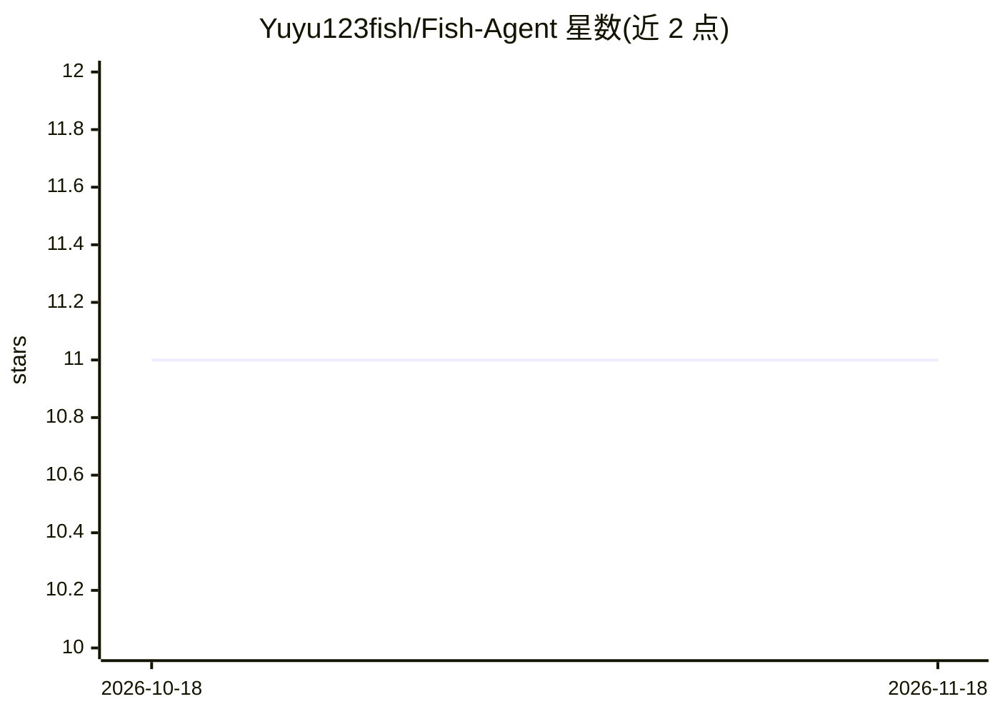

# Yuyu123fish/Fish-Agent

⭐ 11 · Java · 推送 2026-06-28 · [GitHub](https://github.com/Yuyu123fish/Fish-Agent) · 个人维护 · 中文 README

**面向开发者的 Spring AI ReAct 全栈智能体应用**

基于 Spring AI Alibaba ReAct 的 Java + Python + Vue 3 全栈智能体应用，提供流式对话、三层短期记忆、RAG 五级管线（查询扩展、四索引双路召回、RRF 融合、Cross-Encoder 精排）、知识卡片与知识库上传闭环。工程上实现 Resilience4j 熔断、Redis 多级缓存与限流、MDC 全链路追踪。部署需 JDK 21、MySQL、Elasticsearch、Redis、Docker 中间件与 DashScope 或 DeepSeek API Key。

## 筛选速览

| 维度 | 判定 | 备注 |
|---|---|---|
| AI 角色 | `ai-ecosystem` | LLM/agent 周边工具 |
| 许可风险 | `none` | — |
| 部署形态 | `self-host` | docker 或自建部署 |
| 模型依赖 | local-ok | 支持本地模型 |
| 硬件要求 | — | 无带数字的原话,不猜 |
| 安装摩擦 | `low` | 无编译、无系统依赖或容器化 |
| 成熟度 | — | 结构信号不足 |

## 能力要点

- ReAct Agent，10 个工具经 SPI + ToolRegistry 自动发现
- RAG 五级管线：查询扩展→四索引双路召回→RRF→Cross-Encoder 精排
- DashScope / Ollama / DeepSeek 三路模型路由，Chat 与 Embedding 独立配置
- Python Worker 解析 6 种文档格式并结构感知分块入库

## 适用场景

- 搭建带知识库问答与多轮记忆的智能体应用
- 学习 Spring AI 的多模型路由、RAG 管线与工具编排实践
- 参考其熔断、限流、链路追踪等工程化实现

## 场景标签

`文档问答` `RAG` · 领域:知识与检索

## 证据(README 行号)

> L3: 基于 **Spring AI Alibaba ReAct** 的全栈智能体应用。具备三层记忆、五级 RAG 管线、知识库闭环、知识卡片系统、流式对话与多维限流能力；工程化方面实现了 MDC 全链路追踪、Resilience4j 熔断
> L42: |**框架**|Spring Boot 3.5.13 + Spring AI 1.1.4 + Spring AI Alibaba 1.1.2|ReAct Agent + `ModelCallLimitHook`|
> L24: 登录鉴权 → Redis 令牌桶 + SSE 并发限流 → 同会话互斥锁 → TraceFilter 注入 traceId → 多轮 SSE 流式对话 → CircuitBreaker 熔断保护 → 三层短期记忆（L1 Redis

## 星数曲线

2026-10-18 11 → 2026-11-18 11（+0）

---
*卡片 v1 · prompt 1.4 · 生成 2026-11-18 · 置信度 mid · 依据 README sha `9d39e512312d` · [字段定义](../../DATASET.md)*
