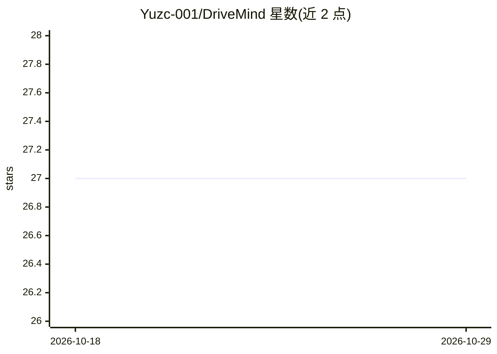

# Yuzc-001/DriveMind

⭐ 27 · PowerShell · NOASSERTION · 推送 2026-04-28 · [GitHub](https://github.com/Yuzc-001/DriveMind) · 个人维护 · 中文 README

**面向 AI agent 的执行可靠性技能包：防漂移、保留边界与经验沉淀**

一个 v0.7 的 agent skill 包，以 SKILL.md 为运行入口，针对六种执行退化模式（目标漂移、边界漂移、连续性衰减、卡滞退化、能力未充分使用、收尾失败）提供参考文档、复盘/日记/蒸馏模板与安装脚本；核心机制是在任务执行前识别可能退化的环节，强制更强的下一步行动，并将有意义的收尾沉淀为可复用经验。以单一便携 drivemind 技能包形式安装到受支持的技能目录，附执行式压力测试用例。

## 筛选速览

| 维度 | 判定 | 备注 |
|---|---|---|
| AI 角色 | `ai-ecosystem` | LLM/agent 周边工具 |
| 许可风险 | `none` | NOASSERTION |
| 部署形态 | `None` |  |
| 模型依赖 | — | README 未给出锁定关系 |
| 硬件要求 | — | 无带数字的原话,不猜 |
| 安装摩擦 | `low` | 无编译、无系统依赖或容器化 |
| 成熟度 | `idea` | |

## 能力要点

- 针对 6 种失败模式（目标漂移/边界漂移/连续性衰减等）的参考文档体系
- 复盘、日记与蒸馏模板用于经验沉淀与下次运行改进
- evals 目录提供 v0.7 可执行压力用例与通过标准
- 单一便携 drivemind 技能包安装到受支持的技能目录

## 适用场景

- 长任务中防止 agent 目标漂移与浅层作答
- 跨会话中断时保留任务连续性
- 任务收尾时沉淀可复用规则供下次运行使用
- 在风险边界前要求人工确认（human-in-the-loop）

## 场景标签

`Agent 记忆` · 领域:Agent 开发

## 证据(README 行号)

> L15: DriveMind is a v0.7 agent skill for improving real task execution.
> L50: - `skill/SKILL.md` — runtime entrypoint
> L77: DriveMind installs as one portable `drivemind` skill package for supported skill directories.

## 星数曲线

2026-10-18 27 → 2026-10-29 27（+0）

---
*卡片 v1 · prompt 1.4 · 生成 2026-10-26 · 置信度 high · 依据 README sha `b5adcd258f80` · [字段定义](../../DATASET.md)*
