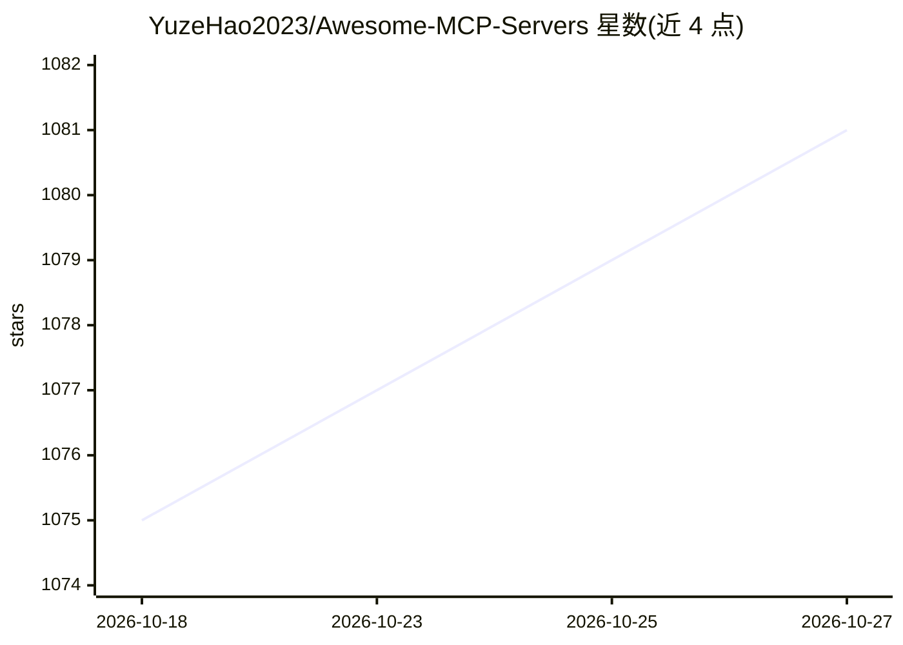

# YuzeHao2023/Awesome-MCP-Servers

⭐ 1,081 · Apache-2.0 · 推送 2026-08-07 · [GitHub](https://github.com/YuzeHao2023/Awesome-MCP-Servers) · 个人维护 · 中文 README

**MCP 服务器与工具的社区策展清单**

社区驱动的 Model Context Protocol（MCP）生态清单：收录官方服务器、参考服务器、社区按 30 个类别（文件系统、数据库、云平台、搜索等）组织的 MCP 服务器实现，以及服务器管理工具（mcp-get、mxcp 等）和客户端列表（Claude Desktop、Cursor、Zed 等）。条目附仓库链接，官方实现以⭐标注，并附运行 MCP 服务器的安全警告与最佳实践，另提供爬虫编制的约 6000 条完整列表及多语言文档。

## 筛选速览

| 维度 | 判定 | 备注 |
|---|---|---|
| AI 角色 | `ai-knowledge` | 知识聚合/清单类 |
| 许可风险 | `permissive` | Apache-2.0 |
| 部署形态 | `library` | 以包/库形式分发 |
| 模型依赖 | — | README 未给出锁定关系 |
| 硬件要求 | — | 无带数字的原话,不猜 |
| 安装摩擦 | `medium` | 含编译或系统依赖之一 |
| 成熟度 | — | 结构信号不足 |

## 能力要点

- 按 30 个类别组织的 MCP 服务器清单
- 收录官方/参考/社区三级服务器实现
- 附 MCP 服务器运行安全警告与最佳实践
- 列出服务器管理工具（mcp-get、mxcp、ToolHive 等）与可用客户端

## 适用场景

- 为 AI 客户端寻找特定功能的 MCP 服务器
- 了解 MCP 生态覆盖的工具与集成范围
- 查找 MCP 服务器安装与管理工具

## 场景标签

`精选清单` · 领域:学习与行业

## 证据(README 行号)

> L5: A curated, community-driven list of awesome Model Context Protocol (MCP) servers, tools, frameworks, clients, and ut
> L24: MCP is an open protocol that enables AI models to securely interact with local and remote resources through standar

## 星数曲线

2026-10-18 1,075 → 2026-10-27 1,081（+6）

---
*卡片 v1 · prompt 1.4 · 生成 2026-10-21 · 置信度 mid · 依据 README sha `fc9ea2c36086` · [字段定义](../../DATASET.md)*
