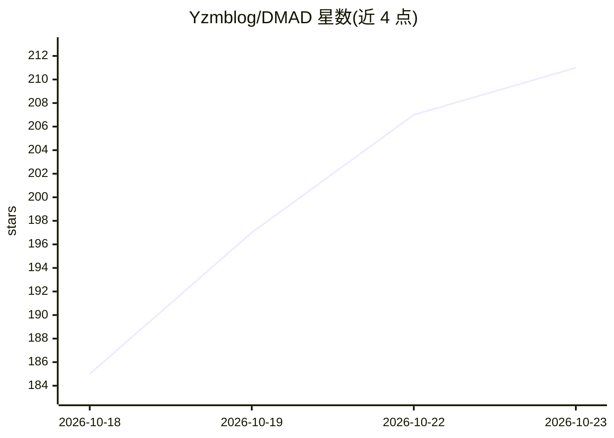

# Yzmblog/DMAD

⭐ 211 · Python · Apache-2.0 · 推送 2026-10-21 · [GitHub](https://github.com/Yzmblog/DMAD) · 组织维护 · 中文 README

**扩散模型对抗蒸馏方法 DMAD 的训练与少步推理代码**

DMAD（Distribution Matching as Adversarial Distillation）将分布匹配蒸馏重构为分类问题，用共享骨干上的两个判别器头学习对数密度比，替代 DMD 中的辅助扩散模型拟合。本仓库提供 MiniMax-H3（33B 文生音视频）4 步学生 LoRA 的推理代码（inference.py、Diffusers 管线、ComfyUI 工作流），以及 ImageNet-64、SDXL、Wan2.1、MiniMax-H3 的训练代码。支持 --low-vram 在 8 GB 消费级 GPU 上分层流式推理，基座模型约 170 GB 需从 Hugging Face 下载并接受 MiniMax H3 Community License。由 Texas A&M 与字节跳动人员共同维护。

## 筛选速览

| 维度 | 判定 | 备注 |
|---|---|---|
| AI 角色 | `ai-native` | 本体是模型或模型工具 |
| 许可风险 | `permissive` | Apache-2.0 |
| 部署形态 | `None` |  |
| 模型依赖 | — | README 未给出锁定关系 |
| 硬件要求 | — | 无带数字的原话,不猜 |
| 安装摩擦 | `medium` | 含编译或系统依赖之一 |
| 成熟度 | — | 结构信号不足 |

## 能力要点

- 4 步生成 1344x768 视频与原生立体声音频的学生 LoRA（rank 128）
- --low-vram 逐层流式推理，8 GB GPU 可生成 5 秒视频，与更大 GPU 输出逐位一致
- 提供 Diffusers 管线封装与 ComfyUI 工作流（4/8 步）
- 含 ImageNet-64/SDXL/Wan2.1/MiniMax-H3 四套训练代码

## 适用场景

- 在消费级 GPU 上少步快速生成带音频的视频
- 复现论文中 DMAD 蒸馏训练与评测流程
- 在 ComfyUI 或 Diffusers 工作流中使用 4 步学生模型

## 场景标签

`视频生成` `微调` · 领域:内容生成

## 证据(README 行号)

> L27: This repository contains the **4-step DMAD students of MiniMax-H3
> L28: (33B, text-to-audio-video)** and the code to run them: a LoRA of rank 128 on the H3 transformer turns the 50-step
> L70: * ⚡️ `inference.py`: few-step sampling with the re-noise step rule the students were trained with

## 星数曲线

2026-10-18 185 → 2026-10-23 211（+26）

---
*卡片 v1 · prompt 1.4 · 生成 2026-10-22 · 置信度 high · 依据 README sha `45bd0911de3c` · [字段定义](../../DATASET.md)*
