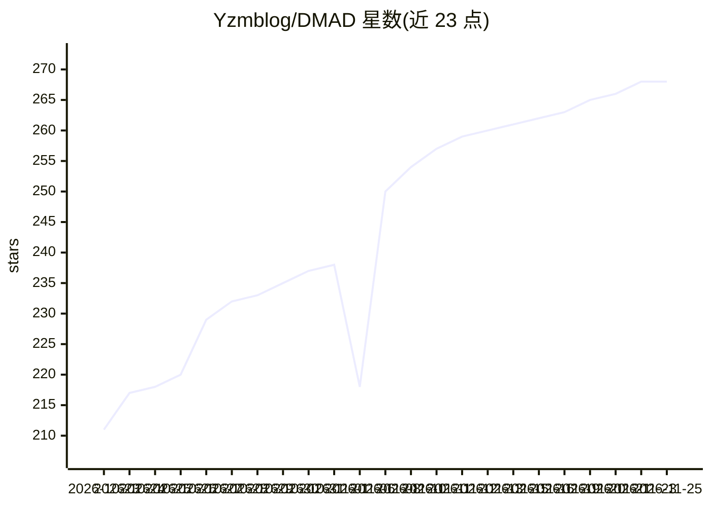

# Yzmblog/DMAD

⭐ 268 · Python · Apache-2.0 · 推送 2026-10-30 · [GitHub](https://github.com/Yzmblog/DMAD) · 组织维护

**少步蒸馏的音频-视频生成模型权重与训练/推理代码库**

DMAD 提出把分布匹配重述为分类任务，用判别器 logits 上的线性损失直接训练少步学生模型，省去 DMD 所需的辅助扩散模型。仓库提供 MiniMax-H3 33B 的三个 rank-128 LoRA 学生（4 步与 8 步）、推理脚本 inference.py、Diffusers 管线示例、ComfyUI 工作流，以及 ImageNet-64、SDXL、Wan2.1、MiniMax-H3 四套训练代码。模型以 LoRA 形式运行在 50 步教师之上，默认输出 1344x768、124 帧 5.2 秒视频并带 32 kHz 立体声。运行需先在 Hugging Face 接受 MiniMax H3 Community License 并下载约 170 GB 基础模型组件。

## 筛选速览

| 维度 | 判定 | 备注 |
|---|---|---|
| AI 角色 | `ai-native` | 本体是模型或模型工具 |
| 许可风险 | `permissive` | Apache-2.0 |
| 部署形态 | `None` |  |
| 模型依赖 | — | README 未给出锁定关系 |
| 硬件要求 | — | 无带数字的原话,不猜 |
| 安装摩擦 | `medium` | 含编译或系统依赖之一 |
| 成熟度 | — | 结构信号不足 |

## 能力要点

- 三个 rank-128 LoRA 学生权重：4 步 lora_critic/full_critic 与 8 步 8step_full_critic（各 1.4 GB）
- --low-vram 支持 8 GB 消费级 GPU，5 秒视频占用低于 7 GiB 显存
- 提供 ComfyUI 键位布局的 LoRA 转换版本与现成工作流（16-24 GB 与 8 GB GPU）
- 四套训练代码（ImageNet-64/SDXL/Wan2.1/MiniMax-H3）及 Wan2.1 训练数据开放

## 适用场景

- 用消费级 GPU 少步生成带立体声音频的视频
- 在 ComfyUI 中挂载 LoRA 直接跑 4/8 步工作流
- 基于开放的训练代码在自有数据上复现 DMAD 蒸馏

## 场景标签

`视频生成` `微调` · 领域:内容生成

## 证据(README 行号)

> L27: This repository contains the **4-step DMAD students of MiniMax-H3
> L73: * ⚡️ `inference.py`: few-step sampling with the re-noise step rule the students were trained with
> L143: classifier-free guidance (MiniMax-H3 is guidance-distilled). The default output is 1344x768, 124 frames (5.2 s at

## 星数曲线

2026-10-23 211 → 2026-11-25 268（+57）

---
*卡片 v1 · prompt 1.4 · 生成 2026-11-25 · 置信度 high · 依据 README sha `49adc2fe2f4a` · [字段定义](../../DATASET.md)*
