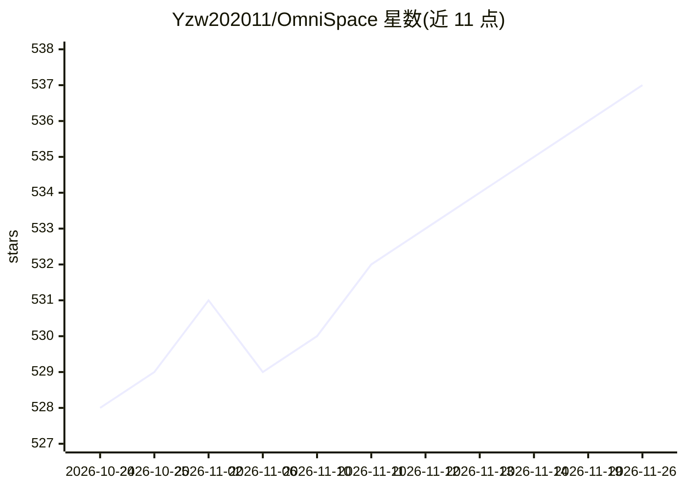

# Yzw202011/OmniSpace

⭐ 537 · Python · 推送 2026-11-24 · [GitHub](https://github.com/Yzw202011/OmniSpace) · 组织维护 · 中文 README

**本地 GPU 上的全栈 AI 漫剧/漫画/写作创作工作站**

面向 Windows + NVIDIA 显卡用户的本地 AI 创作平台，默认全部推理在本机 GPU 完成，云端 API 为自带 Key 的可选项。包含五大模块：AI 对话（多引擎本地推理+RAG）、AI 漫画（角色一致性/分格/气泡/导出）、漫剧创作（分镜→关键帧→视频链路）、写作台（大纲树/质检闸）、知识学习（向量化入库/知识图谱）。通过自研显存协调器在 16GB 消费级显卡上调配多条创作链路，配舱壁隔离与自愈阶梯、备份加密、审计日志等运维底座。仅支持 Windows，依赖 CUDA 12.x，仓库声明仅供学习使用，商业需授权。

## 筛选速览

| 维度 | 判定 | 备注 |
|---|---|---|
| AI 角色 | `ai-native` | 本体是模型或模型工具 |
| 许可风险 | `none` | — |
| 部署形态 | `desktop` | 安装包/桌面程序 |
| 模型依赖 | local-ok | 支持本地模型 |
| 硬件要求 | — | 无带数字的原话,不猜 |
| 安装摩擦 | `medium` | 含编译或系统依赖之一 |
| 成熟度 | `idea` | |

## 能力要点

- vLLM / llama.cpp GGUF / Transformers 多推理引擎热切换，按显存自动路由
- 显存协调器（账本/准入/编排）支持 16GB 显卡运行创作链路
- 漫剧全链路：分镜→资产→关键帧→视频，四种超分模型 × 1K/2K 分档
- 舱壁隔离 + 自愈阶梯 + 备份加密（AES-GCM）+ 断电自恢复

## 适用场景

- 在本地 GPU 上从剧本生成漫画与漫剧成片
- 多引擎本地对话并挂载知识库 RAG 检索
- 用 AI 写长篇小说并做章节质检与世界观管理
- 文档/图片入库学习并生成知识图谱

## 场景标签

`图像生成` `视频生成` `知识图谱` `RAG` · 领域:内容生成

## 证据(README 行号)

> L19: > 💡 **对话 × 漫画 × 漫剧 × 写作 × 知识学习**
> L41: |🏠 **本地优先**|默认所有模型推理跑在你自己的 GPU 上，数据不出本机；云端 API 是可选的自带 Key 档位（页内徽标直连配置）|
> L79: ### 🎨 AI 漫画（Comic）

## 星数曲线

2026-10-24 528 → 2026-11-26 537（+9）

---
*卡片 v1 · prompt 1.4 · 生成 2026-11-26 · 置信度 high · 依据 README sha `178449d35bb5` · [字段定义](../../DATASET.md)*
