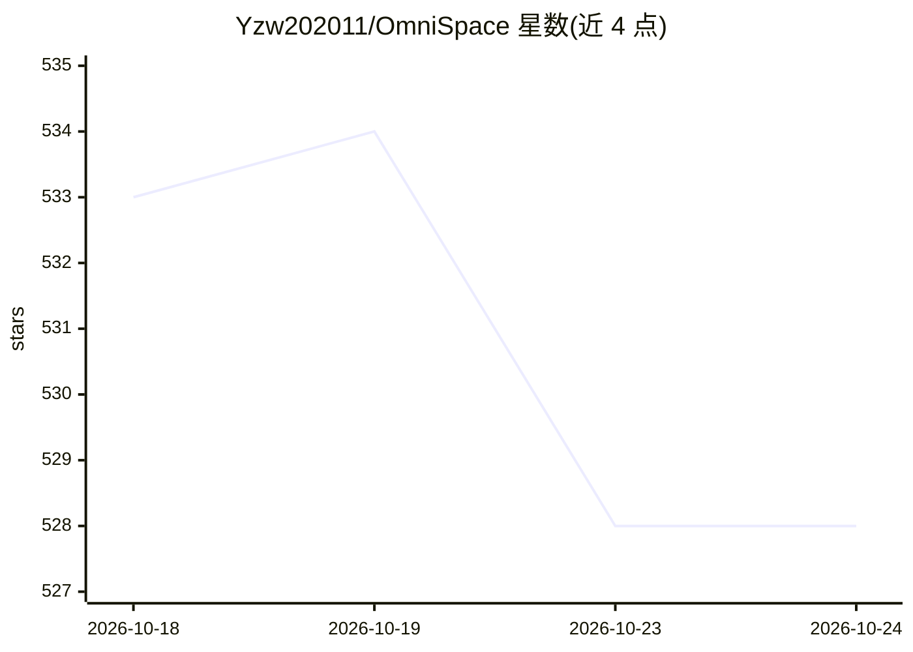

# Yzw202011/OmniSpace

⭐ 528 · Python · 推送 2026-09-20 · [GitHub](https://github.com/Yzw202011/OmniSpace) · 组织维护 · 中文 README

**本地优先的全栈 AI 漫剧创作工作站，本地推理一站式创作**

面向创作者的本地 AI 创作平台，覆盖 AI 对话、AI 漫画（分格/气泡/角色一致性）、漫剧（分镜→资产→关键帧→视频）、写作台（大纲/篇幅规划/降AI味文风）与知识学习（RAG + 知识图谱）五大模块。推理默认跑本地 GPU，vLLM / llama.cpp (GGUF) / Transformers 三引擎热切换，自研显存协调器与舱壁隔离自愈机制；云端 API 为可选自带 Key 档位。运行要求 Windows 10/11 + NVIDIA GPU（16GB 完整档 / 12GB 降级档）+ CUDA 12.x。项目声明仅供学习、商业需授权，Linux/macOS 支持在规划中。

## 筛选速览

| 维度 | 判定 | 备注 |
|---|---|---|
| AI 角色 | `ai-native` | 本体是模型或模型工具 |
| 许可风险 | `none` | — |
| 部署形态 | `desktop` | 安装包/桌面程序 |
| 模型依赖 | local-ok | 支持本地模型 |
| 硬件要求 | `gpu-8g` | |
| 安装摩擦 | `medium` | 含编译或系统依赖之一 |
| 成熟度 | `idea` | |

## 能力要点

- vLLM / llama.cpp / Transformers 多引擎本地推理热切换
- 显存协调器与功能舱壁隔离 + 自愈阶梯
- 剧本→分镜→关键帧→视频的漫剧全链路创作
- CuteMamen 插件系统（子进程沙箱 + AST 安检）

## 适用场景

- 在本机 GPU 上完成漫画/漫剧从剧本到成片的创作
- 写小说并管理大纲、角色、伏笔与世界观
- 搭建本地知识库做 RAG 检索增强问答与学习

## 场景标签

`图像生成` `视频生成` `AI 写作` `RAG` · 领域:内容生成

## 证据(README 行号)

> L19: > 💡 **对话 × 漫画 × 漫剧 × 写作 × 知识学习**
> L33: |🎯 **真·全模态**|文本 / 图像 / 视频 / 语音 / 知识图谱，一站式创作管线|
> L92: - 多引擎本地对话（vLLM / llama.cpp GGUF / Transformers，按显存自动路由）

## 星数曲线

2026-10-18 533 → 2026-10-24 528（-5）

---
*卡片 v1 · prompt 1.4 · 生成 2026-10-21 · 置信度 high · 依据 README sha `7b3b54b40881` · [字段定义](../../DATASET.md)*
