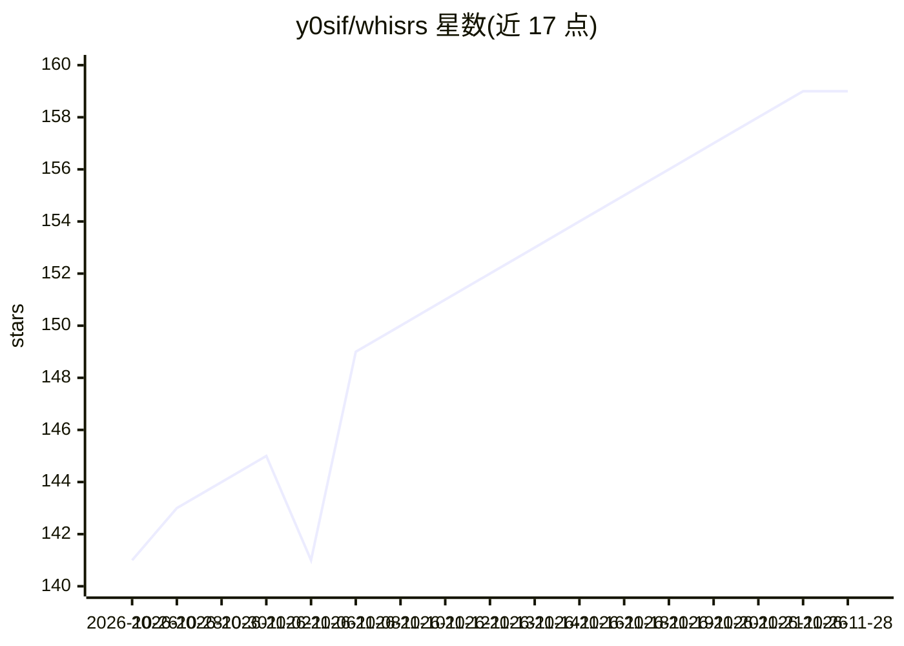

# y0sif/whisrs

⭐ 159 · Rust · MIT · 推送 2026-11-26 · [GitHub](https://github.com/y0sif/whisrs) · [官网](https://y0sif.github.io/whisrs/) · 个人维护

**Linux 桌面语音工具：听写、朗读、会议转录与语音驱动编码代理**

面向 Linux 桌面的语音工具守护进程与 CLI：按热键说话，文字以真实按键输入到光标处，覆盖 Wayland 与 X11（Hyprland、Sway、Niri、GNOME、KDE）。功能含听写、朗读选中文本、LLM 改写、语音驱动编码代理（Claude Code、OpenCode、Codex、GitHub Copilot），以及录制麦克风与系统音频生成带说话人名的 Markdown 会议转录。语音识别可选云后端（Groq、Deepgram、OpenAI、OpenRouter）或经 whisper.cpp 完全离线。Rust 编写，MIT 许可，另提供安装脚本、AUR、Nix 与预编译包。

## 筛选速览

| 维度 | 判定 | 备注 |
|---|---|---|
| AI 角色 | `ai-native` | 本体是模型或模型工具 |
| 许可风险 | `permissive` | MIT |
| 部署形态 | `library` | 以包/库形式分发 |
| 模型依赖 | locked-api |  |
| 硬件要求 | — | 无带数字的原话,不猜 |
| 安装摩擦 | `high` | 编译与系统依赖俱全 |
| 成熟度 | — | 结构信号不足 |

## 能力要点

- 听写以键盘布局真实按键输入，支持 AltGr 与死键
- 云后端与 whisper.cpp 本地离线（Vulkan/CUDA/HIP GPU 加速）双模式
- 语音驱动编码代理与只读 MCP 服务器供 agent 检索录音
- 会议转录输出带时间戳与说话人名的 Markdown，可附 LLM 摘要

## 适用场景

- 在 Wayland/X11 任意应用中按热键语音输入文字
- 完全离线环境的本地语音识别与朗读
- 用语音向编码代理下达任务并听取口头回复
- 录制并转录线上会议为带说话人名的文本

## 场景标签

`语音识别` `语音合成` · 领域:内容生成

## 证据(README 行号)

> L14: **Voice for the Linux desktop: dictation, read-aloud, meeting transcription, voice-driven LLM commands and coding a
> L16: Speech-to-text for Wayland, X11, Hyprland, Sway, Niri, GNOME, and KDE. Press a hotkey, speak, and your words appear

## 星数曲线

2026-10-26 141 → 2026-11-28 159（+18）

---
*卡片 v1 · prompt 1.4 · 生成 2026-11-27 · 置信度 high · 依据 README sha `c6c2c37801fb` · [字段定义](../../DATASET.md)*
