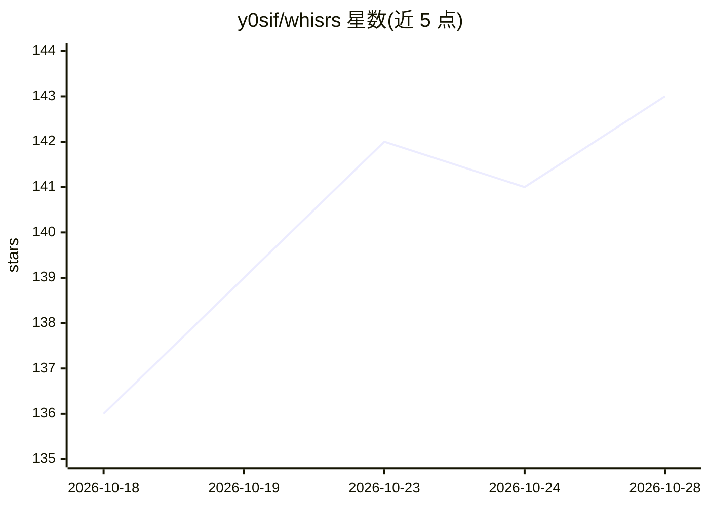

# y0sif/whisrs

⭐ 143 · Rust · MIT · 推送 2026-10-28 · [GitHub](https://github.com/y0sif/whisrs) · [官网](https://y0sif.github.io/whisrs/) · 个人维护

**Linux 桌面语音工具：听写、朗读与语音驱动 LLM 命令**

用 Rust 编写的 Linux 桌面语音层：按热键听写、文本以光标处注入任意应用，支持 Wayland 与 X11 下的 Hyprland、Sway、Niri、GNOME、KDE。转写后端可选云（Groq、Deepgram、OpenAI）或本地 whisper.cpp 全离线；TTS 经 Groq、OpenAI、Deepgram 或本地 sidecar 实现选中文字朗读；另提供语音+LLM 命令（任意 OpenAI 兼容端点）原地改写文本。面向终端用户提供 curl 安装脚本、AUR、Cargo、Nix 等安装途径，GPU 加速需从源码构建。

## 筛选速览

| 维度 | 判定 | 备注 |
|---|---|---|
| AI 角色 | `ai-native` | 本体是模型或模型工具 |
| 许可风险 | `permissive` | MIT |
| 部署形态 | `library` | 以包/库形式分发 |
| 模型依赖 | local-ok | 支持本地模型 |
| 硬件要求 | — | 无带数字的原话,不猜 |
| 安装摩擦 | `medium` | 含编译或系统依赖之一 |
| 成熟度 | — | 结构信号不足 |

## 能力要点

- 8 种转写后端：Groq/Deepgram/OpenAI 云端 + 本地 whisper.cpp 与 ASR sidecar
- 语音+LLM 命令：选中文字口述指令后原地改写（任意 OpenAI 兼容端点）
- 布局感知键盘注入（含 AltGr 与死键），支持多合成器窗口跟踪
- 可同时录制麦克风与系统音频并生成带时间戳的 Markdown 转写稿

## 适用场景

- 在任意 Linux 应用与窗口管理器中按热键语音听写
- 选中文字后用 TTS 朗读，或口述指令让 LLM 原地改写文本
- 在无网络或隐私要求下用本地 whisper.cpp 离线听写

## 场景标签

`语音识别` `语音合成` · 领域:内容生成

## 证据(README 行号)

> L13: **Voice for the Linux desktop, written in Rust: dictation, read-aloud, and voice-driven LLM commands.**
> L15: Speech-to-text for Wayland, X11, Hyprland, Sway, Niri, GNOME, and KDE. Press a hotkey, speak, and your words appear
> L166: |**Local whisper.cpp**|Local (CPU/GPU)|Silence-split phrases|Free|Privacy, offline use|

## 星数曲线

2026-10-18 136 → 2026-10-28 143（+7）

---
*卡片 v1 · prompt 1.4 · 生成 2026-10-23 · 置信度 high · 依据 README sha `a139f6760b7b` · [字段定义](../../DATASET.md)*
