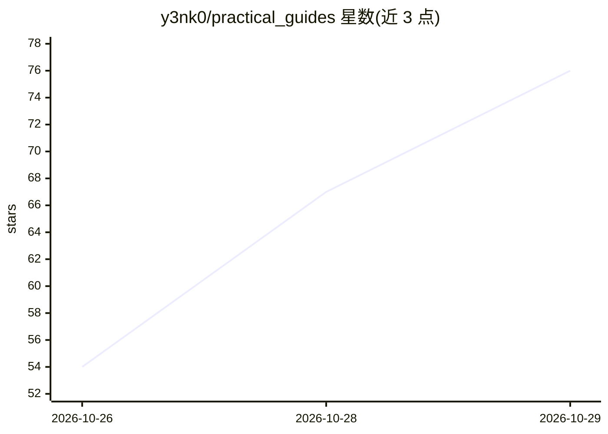

# y3nk0/practical_guides

⭐ 76 · TeX · 推送 2026-10-28 · [GitHub](https://github.com/y3nk0/practical_guides) · 组织维护

**ML/NLP 博士入门与本科论文的实用 LaTeX 指南合集**

由高校教师维护的两套实用指南：面向 ML/NLP 新博士生与本科毕业生的入门与论文写作材料，各含完整 PDF 指南、单页速查表与幻灯片三种格式。内容覆盖会议投稿、文献管理与综述方法、实验习惯、AI 助手使用守则及论文写作答辩等。全部以 LaTeX 编写，编译好的 PDF 已提交至仓库，可直接下载，也可编辑源码用 make 重建，构建结果字节级可复现。

## 筛选速览

| 维度 | 判定 | 备注 |
|---|---|---|
| AI 角色 | `ai-knowledge` | 知识聚合/清单类 |
| 许可风险 | `none` | — |
| 部署形态 | `None` |  |
| 模型依赖 | — | README 未给出锁定关系 |
| 硬件要求 | — | 无带数字的原话,不猜 |
| 安装摩擦 | `low` | 无编译、无系统依赖或容器化 |
| 成熟度 | — | 结构信号不足 |

## 能力要点

- PhD 与本科论文两套指南，各含完整版/单页版/幻灯片三种格式
- 编译好的 PDF 直接随仓库提供，无需自行编译
- Makefile 构建，SOURCE_DATE_EPOCH 固定时间戳，重建结果字节一致
- make check 校验单页版不超页并检查越界行

## 适用场景

- ML/NLP 新博士生第一周获取投稿、文献管理与科研习惯指引
- 本科毕业论文学生在首次导师会面时获取选题与写作路线
- 实验室迎新报告直接复用仓库中的幻灯片

## 场景标签

`科研工具` `教程课程` · 领域:学习与行业

## 证据(README 行号)

> L3: Practical, no-nonsense guides for students — written to be handed out,
> L16: |📘|`phd/phd-ml-nlp-starter-guide.pdf`|20 pages, A4|The full guide — read it through in week one|
> L82: |🎓|`undergrad-thesis/undergrad-thesis-ml-nlp-guide.pdf`|15 pages, A4|The full guide — hand it out at the first supe

## 星数曲线

2026-10-26 54 → 2026-10-29 76（+22）

---
*卡片 v1 · prompt 1.4 · 生成 2026-10-27 · 置信度 high · 依据 README sha `c134dd6c70c1` · [字段定义](../../DATASET.md)*
