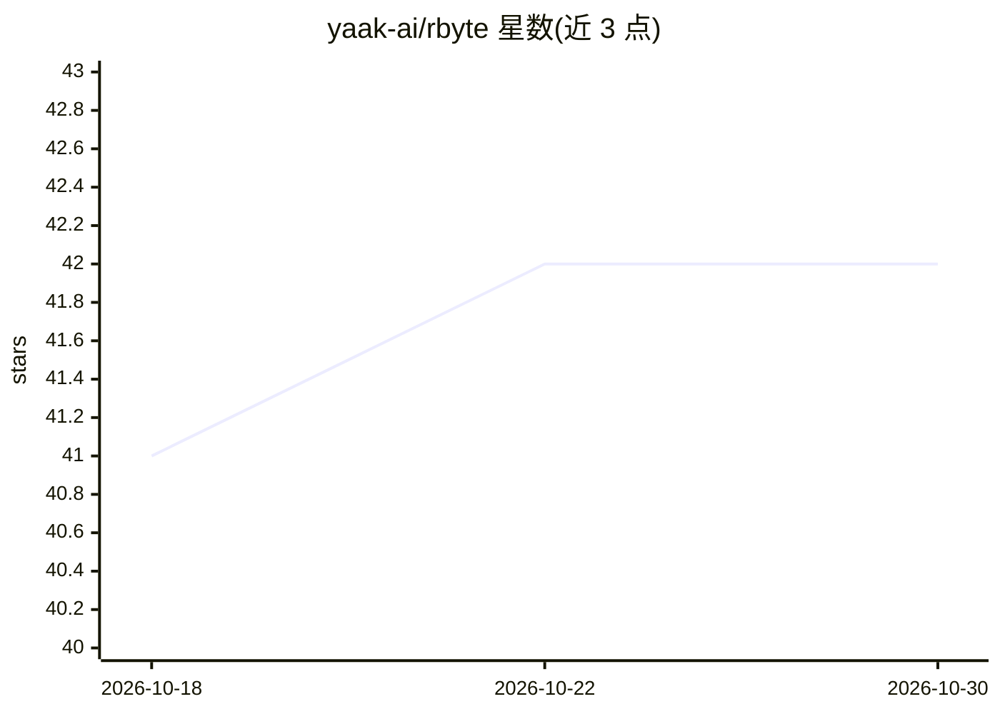

# yaak-ai/rbyte

⭐ 42 · Python · Apache-2.0 · 推送 2026-10-07 · [GitHub](https://github.com/yaak-ai/rbyte) · [官网](https://www.yaak.ai) · 组织维护

**面向空间智能的 PyTorch 多模态数据集加载库**

yaak 维护的 Python 库，实现基于 TensorClass 样本的 PyTorch Dataset，用于从机器人多模态数据构建训练样本，主题涉及 mcap、polars、rerun、tensordict 等数据格式与工具。通过 uv 安装，可用 extras 扩展；示例以 notebook 形式提供（如 nuscenes），开发环境支持 nix。README 简短，细节需查阅 pyproject.toml 与示例工程。

## 筛选速览

| 维度 | 判定 | 备注 |
|---|---|---|
| AI 角色 | `ai-ecosystem` | LLM/agent 周边工具 |
| 许可风险 | `permissive` | Apache-2.0 |
| 部署形态 | `library` | 以包/库形式分发 |
| 模型依赖 | — | README 未给出锁定关系 |
| 硬件要求 | — | 无带数字的原话,不猜 |
| 安装摩擦 | `low` | 无编译、无系统依赖或容器化 |
| 成熟度 | — | 结构信号不足 |

## 能力要点

- 实现 PyTorch Dataset，样本为 TensorClass 结构
- 面向多模态机器人/空间智能数据
- 提供 nuscenes 示例 notebook
- 支持 uv 安装与 nix 开发环境

## 适用场景

- 为机器人/自动驾驶多模态数据构建 PyTorch 训练管线
- 以 TensorClass 结构组织多模态样本
- 复用 nuscenes 示例快速上手数据加载

## 场景标签

 · 领域:机器人/机器学习数据工具

## 证据(README 行号)

> L9: `rbyte` implements a PyTorch `Dataset` with `TensorClass`-based samples built from multimodal data.

## 星数曲线

2026-10-18 41 → 2026-10-30 42（+1）

---
*卡片 v1 · prompt 1.4 · 生成 2026-10-25 · 置信度 mid · 依据 README sha `c5f7367f28cc` · [字段定义](../../DATASET.md)*
