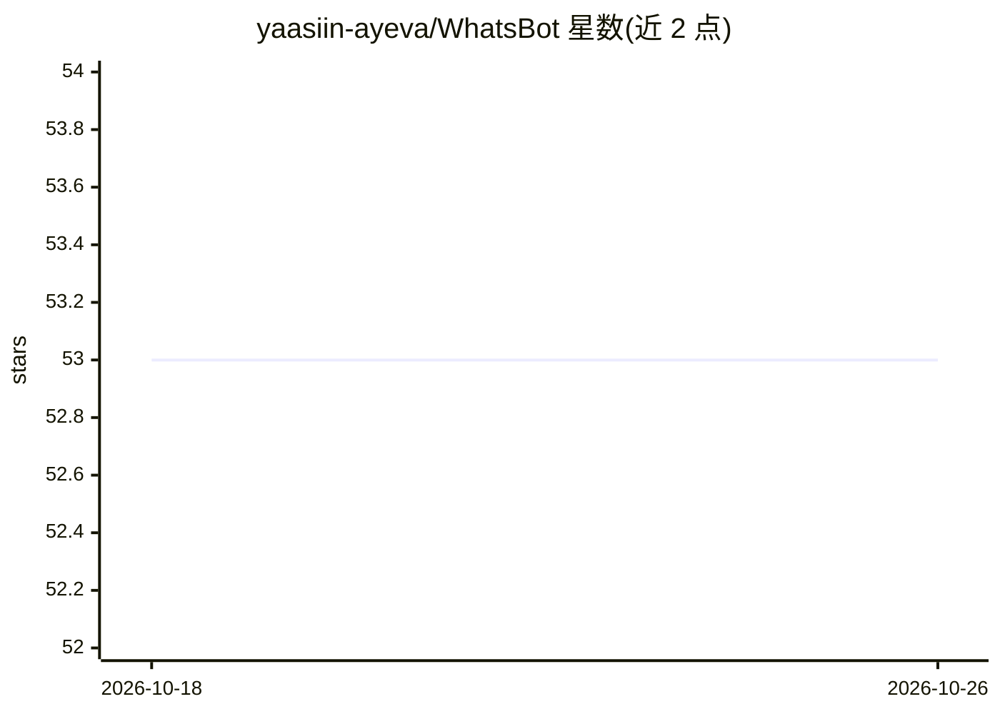

# yaasiin-ayeva/WhatsBot

⭐ 53 · TypeScript · MIT · 推送 2026-08-11 · [GitHub](https://github.com/yaasiin-ayeva/WhatsBot) · [官网](https://yaasiin-dev.vercel.app) · 个人维护

**带 AI 对话与 CRM 的自托管 WhatsApp 机器人**

基于 NodeJS/TypeScript 与非官方 whatsapp-web.js 的 WhatsApp 机器人：支持 Gemini/GPT/Claude 文字对话、本地 sherpa-onnx 语音消息识别与回复、社交媒体视频下载（上限 150 MB）、翻译/天气等工具命令、群聊活动 AI 摘要。内置 /admin 后台 CRM（15 个标签页），含联系人管理、批量营销活动、模板、审计日志、Webhook/Slack/Discord 集成。通过 Docker、PM2 或本地 npm 部署，需 Chrome/Chromium 与 MongoDB；README 声明使用非官方 API 存在封号风险。

## 筛选速览

| 维度 | 判定 | 备注 |
|---|---|---|
| AI 角色 | `ai-native` | 本体是模型或模型工具 |
| 许可风险 | `permissive` | MIT |
| 部署形态 | `desktop` | 安装包/桌面程序 |
| 模型依赖 | locked-api |  |
| 硬件要求 | — | 无带数字的原话,不猜 |
| 安装摩擦 | `low` | 无编译、无系统依赖或容器化 |
| 成熟度 | — | 结构信号不足 |

## 能力要点

- Gemini/GPT/Claude 三模型对话命令，管理后台可配置切换
- 本地 sherpa-onnx 语音消息 STT/TTS，模型自动下载
- 含营销活动、联系人打分、审计日志的 15 标签页 CRM 后台
- 社交媒体视频下载（≤150 MB）与多语言翻译等工具命令

## 适用场景

- 给自己的 WhatsApp 号码接入 AI 聊天与语音回复
- 运营 WhatsApp 联系人并批量发送营销活动
- 下载 TikTok/Instagram 等平台视频到对话中
- 生成群聊某时间段的 AI 摘要

## 场景标签

`聊天机器人` `语音识别` `语音合成` · 领域:对话与助手

## 证据(README 行号)

> L12:  Built with NodeJS & TypeScript, powered by Gemini, OpenAI GPT, Claude, and local sherpa-onnx speech
> L18: - **AI chat**: Gemini (`/chat`), OpenAI GPT (`/gpt`), Claude (`/claude`)

## 星数曲线

2026-10-18 53 → 2026-10-26 53（+0）

---
*卡片 v1 · prompt 1.4 · 生成 2026-10-24 · 置信度 high · 依据 README sha `3086e489ad62` · [字段定义](../../DATASET.md)*
