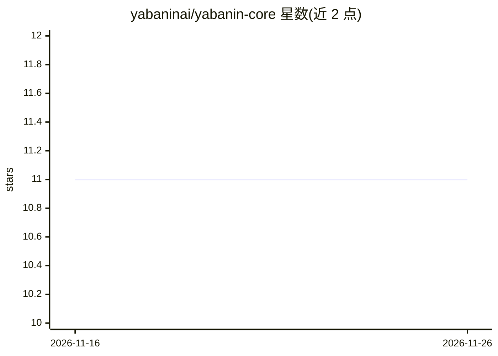

# yabaninai/yabanin-core

⭐ 11 · Go · Apache-2.0 · 推送 2026-11-25 · [GitHub](https://github.com/yabaninai/yabanin-core) · [官网](https://yabanin.ai) · 组织维护

**自托管 AI 网关：统一接入、路由、管控与审计模型请求**

以 Apache-2.0 自托管发布的 AI/ML 网关（当前为 Developer Preview）。提供 OpenAI/Anthropic 兼容 API 与 Codex 风格路由，把应用请求转发到各模型提供方；内置模型分级路由、重试与故障切换、精确/语义缓存、影子模式、组织与预算控制、请求日志与成本/CO₂e 估算，以及 YAML 策略管道（PII、注入检测、脱敏等 20 个内置组件）与 MCP/A2A 工具治理。Docker Compose 一键起本地全栈，也可从 Go 源码构建。

## 筛选速览

| 维度 | 判定 | 备注 |
|---|---|---|
| AI 角色 | `ai-ecosystem` | LLM/agent 周边工具 |
| 许可风险 | `permissive` | Apache-2.0 |
| 部署形态 | `self-host` | docker 或自建部署 |
| 模型依赖 | — | README 未给出锁定关系 |
| 硬件要求 | — | 无带数字的原话,不猜 |
| 安装摩擦 | `low` | 无编译、无系统依赖或容器化 |
| 成熟度 | `idea` | |

## 能力要点

- OpenAI/Anthropic 兼容路由与 BYOK 加密密钥管理
- easy/medium/hard 任务分级路由、重试、熔断与缓存
- 20 个内置检测/改写组件的策略管道，Git 配置即代码
- 组织级预算、Agent 身份密钥与 MCP/A2A 工具治理

## 适用场景

- 为多个应用统一代理 OpenAI/Anthropic 模型请求
- 给团队/组织配置 API 密钥、限流与预算上限
- 用策略管道拦截 PII 与提示注入并做脱敏
- 导出请求日志做离线成本与用量审计

## 场景标签

`模型网关` · 领域:Agent 开发

## 证据(README 行号)

> L6: Yabanin Core is a self-hosted AI gateway. Connect applications through
> L7: OpenAI-compatible or Anthropic-compatible APIs, route requests to model
> L8: providers, manage access and budgets, and inspect request logs and usage.

## 星数曲线

2026-11-16 11 → 2026-11-26 11（+0）

---
*卡片 v1 · prompt 1.4 · 生成 2026-11-18 · 置信度 high · 依据 README sha `f0786071d161` · [字段定义](../../DATASET.md)*
