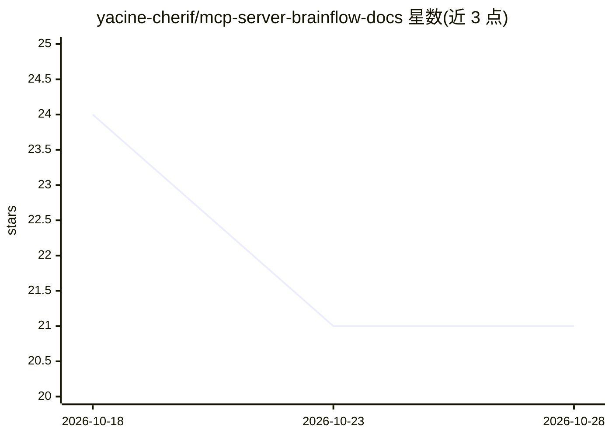

# yacine-cherif/mcp-server-brainflow-docs

⭐ 21 · 推送 2026-05-21 · [GitHub](https://github.com/yacine-cherif/mcp-server-brainflow-docs) · [官网](https://brain-flow.ai/mcp) · 组织维护

**将团队邮件转化为公司共享记忆的 BrainFlow MCP 服务器文档**

BrainFlow 商业服务的 MCP 服务器设置文档：通过在邮件中抄送 BrainFlow 地址自动摄取并索引团队邮件，销售/法务/产品等跨团队对话汇入公司级工作区；AI 助手经 MCP 用自然语言提问，由 AI 转译为 SQL 查询邮件、任务、交易与决策并返回带来源的答案。支持 Claude（Web/Desktop）、ChatGPT、Gemini、Cursor、VS Code。安全机制：只读 SELECT、解析层阻断写操作与子查询、按 company_id 自动过滤、API key SHA-256 校验与使用审计。需订阅 BrainFlow（$19.90/mo 起，含 7 天试用）。

## 筛选速览

| 维度 | 判定 | 备注 |
|---|---|---|
| AI 角色 | `ai-ecosystem` | LLM/agent 周边工具 |
| 许可风险 | `none` | — |
| 部署形态 | `None` |  |
| 模型依赖 | locked-api |  |
| 硬件要求 | — | 无带数字的原话,不猜 |
| 安装摩擦 | `low` | 无编译、无系统依赖或容器化 |
| 成熟度 | — | 结构信号不足 |

## 能力要点

- 邮件抄送自动摄取并索引团队对话
- 自然语言查询由 AI 转译为 SQL，返回带原文链接的答案
- 只读 SELECT，解析层阻断 INSERT/DELETE/子查询等操作
- 多平台接入：Claude Web/Desktop、ChatGPT、Gemini、Cursor、VS Code

## 适用场景

- 把团队邮件历史变成可被 AI 助手查询的共享记忆
- 跨团队交接时查询销售承诺、法务反馈与产品决策
- 汇总客户反馈、议题频率等公司级洞察

## 场景标签

 · 领域:企业协作/知识管理

## 证据(README 行号)

> L3: Your company's brain, connected to Claude, ChatGPT, Gemini, Cursor, and VS Code. Turn your team's email history into
> L14: - **Multi-Platform** — Works with Claude (Web + Desktop), ChatGPT, Gemini, Cursor, and VS Code Copilot.

## 星数曲线

2026-10-18 24 → 2026-10-28 21（-3）

---
*卡片 v1 · prompt 1.4 · 生成 2026-10-28 · 置信度 high · 依据 README sha `cc66019b2e35` · [字段定义](../../DATASET.md)*
